<!-- GENERATED by scripts/build.mjs from catalog/dashboards.json. Do not edit by hand. -->

# Dashboard gallery catalog

38 dashboards in 10 style families. Source: [catalog/dashboards.json](../../catalog/dashboards.json). How to choose and how to add: [README](README.md).

| # | Dashboard | Style | Use cases | Mode | Variants | Folder |
|---|---|---|---|---|---|---|
| 1 | [Horizon Weather](#horizon-weather) | Cinematic & atmospheric | Weather & climate, Travel & places | dark | Dusk, Dawn, Night | [site/dashboards/horizon-weather/](../../site/dashboards/horizon-weather/) |
| 2 | [Pulsar Analytics](#pulsar-analytics) | Dark neon | Analytics & BI, SaaS admin | dark | Violet mint, Ember, Daylight | [site/dashboards/pulsar-analytics/](../../site/dashboards/pulsar-analytics/) |
| 3 | [Solstice Energy](#solstice-energy) | Cinematic & atmospheric | Analytics & BI, Smart home & IoT | dark | Ember, Glacier, Paper | [site/dashboards/solstice-energy/](../../site/dashboards/solstice-energy/) |
| 4 | [Kumo Payroll](#kumo-payroll) | Cinematic & atmospheric | HR & people, Finance & banking | dark | Moonlit gold, Jade, Sakura | [site/dashboards/kumo-payroll/](../../site/dashboards/kumo-payroll/) |
| 5 | [Canopy Reforest](#canopy-reforest) | Soft & friendly | Projects & tasks, Analytics & BI | dark | Forest, Autumn, Birch | [site/dashboards/canopy-reforest/](../../site/dashboards/canopy-reforest/) |
| 6 | [Ridgeline Trails](#ridgeline-trails) | Editorial | Travel & places, Analytics & BI | light | Mist, Dusk, Pine night | [site/dashboards/ridgeline-trails/](../../site/dashboards/ridgeline-trails/) |
| 7 | [Haven Listings](#haven-listings) | Glass & glow | Real estate | light | Dusk, Sunrise, Midnight | [site/dashboards/haven-listings/](../../site/dashboards/haven-listings/) |
| 8 | [Aura Ring](#aura-ring) | Glass & glow | Health & fitness | dark | Haze, Lagoon, Pearl | [site/dashboards/aura-ring/](../../site/dashboards/aura-ring/) |
| 9 | [Lull Sleep](#lull-sleep) | Soft & friendly | Health & fitness | light | Lavender, Dawn, Nightfall | [site/dashboards/lull-sleep/](../../site/dashboards/lull-sleep/) |
| 10 | [Pearlwell Dental](#pearlwell-dental) | Soft & friendly | Health & fitness | light | Mint, Coral, Deep sea | [site/dashboards/pearlwell-dental/](../../site/dashboards/pearlwell-dental/) |
| 11 | [Vitalis Care](#vitalis-care) | Bento grid | Health & fitness | light | Teal, Sage, Night | [site/dashboards/vitalis-care/](../../site/dashboards/vitalis-care/) |
| 12 | [Mallow Music](#mallow-music) | Tactile & neumorphic | Music & media | light | Cream, Berry, Cocoa | [site/dashboards/mallow-music/](../../site/dashboards/mallow-music/) |
| 13 | [Taffy Analytics](#taffy-analytics) | Minimal & airy | SaaS admin, Analytics & BI | light | Taffy, Mint, Dusk | [site/dashboards/taffy-analytics/](../../site/dashboards/taffy-analytics/) |
| 14 | [Prism Workspace](#prism-workspace) | Glass & glow | SaaS admin | light | Opal, Aqua, Obsidian | [site/dashboards/prism-workspace/](../../site/dashboards/prism-workspace/) |
| 15 | [Plumage Bird Survey](#plumage-survey) | Cinematic & atmospheric | Analytics & BI | dark | Plume, Canopy, Ember | [site/dashboards/plumage-survey/](../../site/dashboards/plumage-survey/) |
| 16 | [Hollow Vault](#hollow-vault) | Dark neon | Music & media | dark | Dusk, Moss, Crimson | [site/dashboards/hollow-vault/](../../site/dashboards/hollow-vault/) |
| 17 | [Larchwood Lodge](#larchwood-lodge) | Bento grid | Hospitality & food, Smart home & IoT | dark | Plum, Birch, Pine | [site/dashboards/larchwood-lodge/](../../site/dashboards/larchwood-lodge/) |
| 18 | [Hearth Nest](#hearth-nest) | Cinematic & atmospheric | Smart home & IoT | dark | Amber hearth, Cedar, Frost | [site/dashboards/hearth-nest/](../../site/dashboards/hearth-nest/) |
| 19 | [Veil Rooms](#veil-rooms) | Glass & glow | Smart home & IoT | dark | Slate glass, Mist, Midnight | [site/dashboards/veil-rooms/](../../site/dashboards/veil-rooms/) |
| 20 | [Atrium Living](#atrium-living) | Glass & glow | Smart home & IoT | light | Daylight, Dusk, Night | [site/dashboards/atrium-living/](../../site/dashboards/atrium-living/) |
| 21 | [Glacier Ops](#glacier-ops) | Data-dense pro | Analytics & BI | dark | Glacier, Cobalt, Night | [site/dashboards/glacier-ops/](../../site/dashboards/glacier-ops/) |
| 22 | [Folio Club](#folio-club) | Soft & friendly | Education, Music & media | dark | Ink, Parchment, Night | [site/dashboards/folio-club/](../../site/dashboards/folio-club/) |
| 23 | [Citadel Wall](#citadel-wall) | Data-dense pro | Analytics & BI, Logistics & fleet | dark | Cyan, Ocean, Amber | [site/dashboards/citadel-wall/](../../site/dashboards/citadel-wall/) |
| 24 | [Aether Pane](#aether-pane) | Glass & glow | Analytics & BI, SaaS admin | dark | Cyan, Violet, Daylight | [site/dashboards/aether-pane/](../../site/dashboards/aether-pane/) |
| 25 | [Forge Fitness](#forge-fitness) | Cinematic & atmospheric | Health & fitness | dark | Forge, Ember, Ice | [site/dashboards/forge-fitness/](../../site/dashboards/forge-fitness/) |
| 26 | [Zest Health](#zest-health) | Bold & graphic | Health & fitness | light | Lime, Grape, Night | [site/dashboards/zest-health/](../../site/dashboards/zest-health/) |
| 27 | [Orchard Sales](#orchard-sales) | Bento grid | CRM & sales, Analytics & BI | light | Orchard, Citrus, Graphite | [site/dashboards/orchard-sales/](../../site/dashboards/orchard-sales/) |
| 28 | [Mauve Ledger](#mauve-ledger) | Glass & glow | Finance & banking | light | Lilac, Blush, Slate | [site/dashboards/mauve-ledger/](../../site/dashboards/mauve-ledger/) |
| 29 | [Tidebath Showroom](#tidebath-showroom) | Soft & friendly | E-commerce & retail, Hospitality & food | light | Porcelain, Mist, Dusk | [site/dashboards/tidebath-showroom/](../../site/dashboards/tidebath-showroom/) |
| 30 | [Dune Panels](#dune-panels) | Tactile & neumorphic | Analytics & BI | light | Sand, Coastal, Ember | [site/dashboards/dune-panels/](../../site/dashboards/dune-panels/) |
| 31 | [Pebble Studio](#pebble-studio) | Tactile & neumorphic | SaaS admin | light | Cream, Coral, Moss | [site/dashboards/pebble-studio/](../../site/dashboards/pebble-studio/) |
| 32 | [Copper Radar](#copper-radar) | Soft & friendly | Analytics & BI | light | Copper, Slate, Ember | [site/dashboards/copper-radar/](../../site/dashboards/copper-radar/) |
| 33 | [Orbit Clay](#orbit-clay) | Tactile & neumorphic | Music & media | light | Orbit, Moss, Dusk | [site/dashboards/orbit-clay/](../../site/dashboards/orbit-clay/) |
| 34 | [Saffron Dusk](#saffron-dusk) | Glass & glow | Health & fitness, Education | light | Dusk, Dawn, Night | [site/dashboards/saffron-dusk/](../../site/dashboards/saffron-dusk/) |
| 35 | [Clima Pane](#clima-pane) | Glass & glow | Smart home & IoT | light | Amber pane, Sky, Dusk | [site/dashboards/clima-pane/](../../site/dashboards/clima-pane/) |
| 36 | [Meridian Labs](#meridian-labs) | Soft & friendly | Health & fitness | light | Soft blue, Citrus, Night | [site/dashboards/meridian-labs/](../../site/dashboards/meridian-labs/) |
| 37 | [Cortex Well](#cortex-well) | Glass & glow | Health & fitness | light | Lilac haze, Rose mist, Dusk violet | [site/dashboards/cortex-well/](../../site/dashboards/cortex-well/) |
| 38 | [Ember Rooms](#ember-rooms) | Tactile & neumorphic | Smart home & IoT | light | Ember, Mist, Dusk | [site/dashboards/ember-rooms/](../../site/dashboards/ember-rooms/) |

## Cinematic & atmospheric

Dark, moody, scenic backdrops (painted or photographic) with glass panels and one warm accent. For consumer products that should feel like an experience.

### 1. Horizon Weather

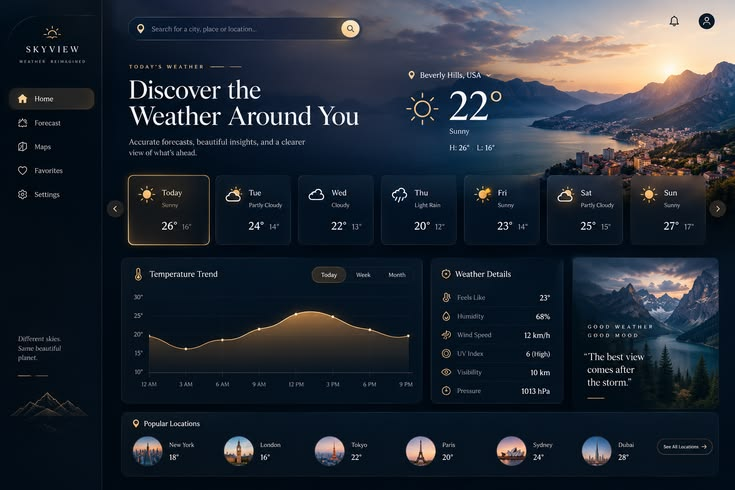

_Horizon Weather · original owner reference (`reference.jpg`; recreation `shot.jpg`, card `thumb.jpg`)._

A cinematic dark weather board: sunset coast photo hero, gold-accent glass forecast cards, forest story panel, and circular city location thumbs — plus Forecast, Maps and Settings pages.

- **Use cases:** Weather & climate, Travel & places · **Mode:** dark · **Mood:** cinematic, calm, premium, warm, editorial
- **Pages:** Overview (`overview`, Dashboard) · Forecast (`forecast`, Report) · Maps (`maps`, Detail) · Settings (`settings`, Settings)
- **Motion:** count-up, stagger, hover-lift, press, page-transition, ambient, skeleton, toast, icon-state
- **Signature:** Painted-feeling sunset coast photograph behind frosted gold glass cards, with circular city thumbs along the popular locations strip.
- **Layout:** Fixed left sidebar (brand, 5-item nav, quote) · top bar (pill search, bell, avatar) · hero (headline left, current conditions right) over a painted scene · 7-day strip · 3 columns: area chart, details list, story card · popular-locations row
- **Responsive:** ≤1180px: chart spans full width above details + story · ≤960px: sidebar becomes a top bar, hero stacks · ≤640px: single column, icon-only nav, day strip scrolls horizontally
- **Fonts:** Cormorant Garamond / Manrope · **Palette:** bg `#0b0f17`, surface `#121722`, text `#f4efe6`, muted `#b7b2a8`, accent `#e2b26a`, sky `#6b4a5a`, glow `#e59a5c`
- **Variants:** Dusk, Dawn, Night · **Closest toolkit theme:** `ember`

**Best for**
- Consumer apps where the feeling matters as much as the numbers
- Travel, outdoor, hospitality or lifestyle dashboards
- Landing-page heroes for a data product

**Avoid when**
- Dense business data (tables, many KPIs): the scenery competes with numbers
- Light-mode-only brands
- Low-end devices that struggle with backdrop blur

**Components:** Photo coast hero with vignette · Slim brand sidebar with ridge mark · Pill search with gold go button · 7-day forecast scroller · Temperature trend chart · Weather details list · Forest photo story card · Circular location thumbs · Forecast / Maps / Settings multipage views

---

### 3. Solstice Energy

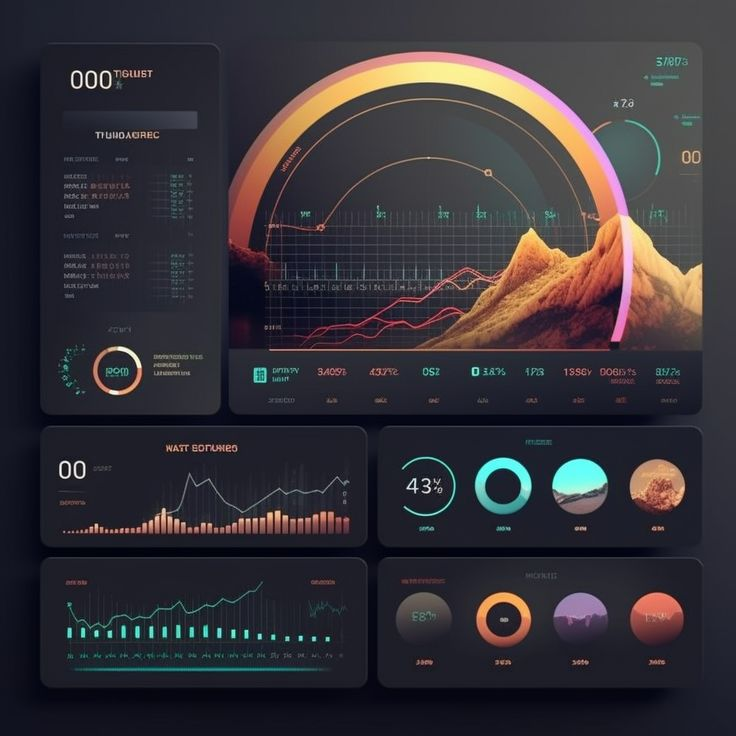

_Solstice Energy · original owner reference (`reference.jpg`; recreation `shot.jpg`, card `thumb.jpg`)._

A cinematic solar-monitoring board: a thick gradient sun-path arc rises over a soft mountain photo, with generation and load curves on a teal grid, a tighter readout strip, storage dials and photo site thumbs.

- **Use cases:** Analytics & BI, Smart home & IoT · **Mode:** dark · **Mood:** cinematic, warm, technical, atmospheric, instrument-like
- **Pages:** Overview (`overview`, Dashboard) · Arrays (`rooms`, List) · Storage (`devices`, List) · Reports (`energy`, Report) · Settings (`settings`, Settings)
- **Motion:** count-up, stagger, hover-lift, press, page-transition, ambient, skeleton, toast, icon-state
- **Signature:** A thick yellow-to-orange-to-pink arc tracing the sun's path over a soft mountain photo; the sun dot moves to the hour you pick.
- **Layout:** Slim top bar (brand, 4-item nav, date, 2 icon buttons) · 12-column grid at 1440px, 18px gaps: 3-column rail (today's total, strings table, self-powered ring) + 9-column hero (sun arc scene, hourly chart, 6-item readout strip) · then 2×2 half-width panels (output bars with range toggle, 4 storage dials, hourly load bars, 4 site thumbnails)
- **Responsive:** ≤1180px: hero full width on top, rail becomes a two-column panel below · ≤760px: single column, hero chart 130px, readout strip 3×2, dials and sites 2×2
- **Fonts:** Chakra Petch / IBM Plex Sans · **Palette:** bg `#17181c`, surface `#24252a`, text `#f3eee7`, muted `#c4bdb3`, accent `#ff9a4a`, teal `#3fd6c0`, coral `#ff6a5c`, pink `#f08ad0`
- **Variants:** Ember, Glacier, Paper · **Closest toolkit theme:** `ember`

**Best for**
- Energy, solar, climate or outdoor-equipment monitoring
- A single hero metric that follows the time of day
- Control-room or kiosk screens with a strong visual identity

**Avoid when**
- Many records to scan or edit: the hero scene takes most of the first screen
- Brands that need a neutral, corporate look
- Data with no natural day cycle or location

**Components:** Sun-path arc scene with movable sun over mountain photo · Two-series hourly line chart (pick an hour) · Readout strip (4 values) · Hero number with unit · Status table with state dots · Progress rings and liquid-fill dial · Bar chart with range toggle · Round landscape photo site picker

---

### 4. Kumo Payroll

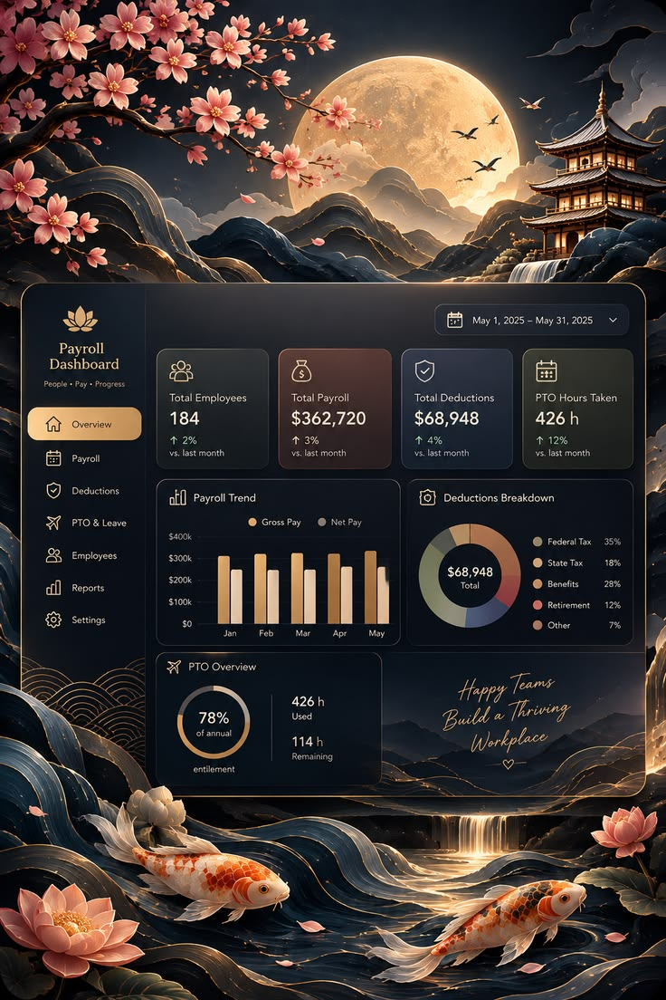

_Kumo Payroll · original owner reference (`reference.jpg`; recreation `shot.jpg`, card `thumb.jpg`)._

A moonlit payroll overview: a code-drawn ink landscape with a gold moon, layered hills and a blossom branch sits behind one dark, gold-edged panel holding KPI tiles, a gross/net bar chart, a deductions donut and time-off ring.

- **Use cases:** HR & people, Finance & banking · **Mode:** dark · **Mood:** cinematic, serene, luxurious, eastern, warm
- **Pages:** Overview (`overview`, Dashboard) · People (`people`, List) · Payroll (`payroll`, Report) · Settings (`settings`, Settings)
- **Motion:** _none yet_
- **Signature:** A glowing gold moon, ink-line hills and a cherry-blossom branch drawn in SVG behind a dark panel with a thin gold edge.
- **Layout:** Fixed illustrated scene behind the page · one centred panel, max 1240px, offset 210px from the top so the moon shows · inside: 216px sidebar (brand, 7-item nav, wave pattern) + 12-column main grid, 16px gaps: header with pay-period stepper · 4 KPI tiles · trend chart (7 cols) + deductions (5 cols) · time off (6) + next steps (6)
- **Responsive:** ≤1080px: sidebar becomes a scrolling top nav, KPIs 2×2, cards stack · ≤640px: panel offset 130px, icon-only nav, period stepper full width, donut and legend stack
- **Fonts:** Marcellus / Mulish · **Palette:** bg `#0b0d14`, surface `#151823`, text `#f5ecdc`, muted `#bdb3a2`, accent `#e2bd7a`, gold `#d9a95a`, petal `#f3a2ae`, indigo `#6f86b8`
- **Variants:** Moonlit gold, Jade, Sakura · **Closest toolkit theme:** `noir`

**Best for**
- HR, payroll or people tools that want a calm, premium feeling
- Hospitality, wellness or boutique brands with an illustrated identity
- Monthly summaries with a handful of headline figures

**Avoid when**
- Dense employee tables or bulk editing: the single framed panel limits width
- Brands that need a neutral enterprise look
- Screens that must fill a wide monitor edge to edge

**Components:** Sidebar nav with gold active pill · Pay-period stepper · Tinted KPI tiles with change vs. last month · Grouped bar chart (pick a month) · Donut with selectable legend · Progress ring with stat grid · Dated task list · Serif pull quote

---

### 15. Plumage Bird Survey

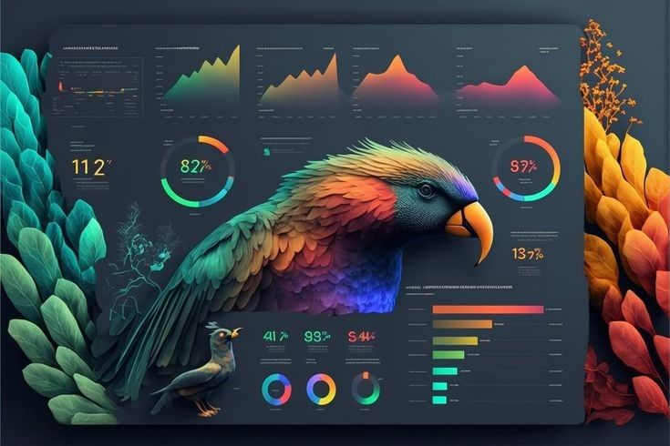

_Plumage Bird Survey · original owner reference (`reference.jpg`; recreation `shot.jpg`, card `thumb.jpg`)._

A dark, cinematic monitoring dashboard for a volunteer coastal bird survey. A painted rainbow-feathered lorikeet sits between leaf walls, framed by gradient region charts, coverage and nesting rings, species bars and an observation log.

- **Use cases:** Analytics & BI · **Mode:** dark · **Mood:** vivid, natural, dramatic, rich, lively
- **Pages:** Overview (`overview`, Dashboard) · Reports (`reports`, Report) · Segments (`segments`, List) · Settings (`settings`, Settings)
- **Motion:** count-up, stagger, hover-lift, press, page-transition, ambient, skeleton, toast, icon-state
- **Signature:** A painted rainbow lorikeet between teal and amber leaf walls, with every chart reusing the same feather colours.
- **Layout:** Top bar: mark, name, season toggle · 4 region spark cards · 12-column grid: species KPI + coverage ring (3) + hero art with caption (6) + nesting ring and habitat donuts (3) · species bars (6) + observation log (6)
- **Responsive:** ≤1100px: regions 2×2, art full width, KPI and rings side by side, bars and log full width · ≤700px: single column, caption moves under the art
- **Fonts:** Space Grotesk / Sora · **Palette:** bg `#171b20`, surface `#20262d`, text `#eef2f4`, muted `#b4bec7`, accent `#3ccbb0`, amber `#f2b43c`, orange `#f07a3a`, violet `#8a63ff`
- **Variants:** Plume, Canopy, Ember · **Closest toolkit theme:** `ember`

**Best for**
- Ecology, conservation and citizen-science reporting
- Public-facing impact dashboards that need a memorable hero
- Seasonal monitoring with a few headline numbers

**Avoid when**
- Dense operational tools used all day
- Calm or corporate brands
- Screens where the art would push data below the fold on small laptops

**Components:** Season toggle · Region spark cards with gradient fills · Headline count · Arc gauges · Mini habitat donuts · Ranked gradient bars that filter the log · Observation log with empty state · Painted bird and leaf-wall photo props

---

### 18. Hearth Nest

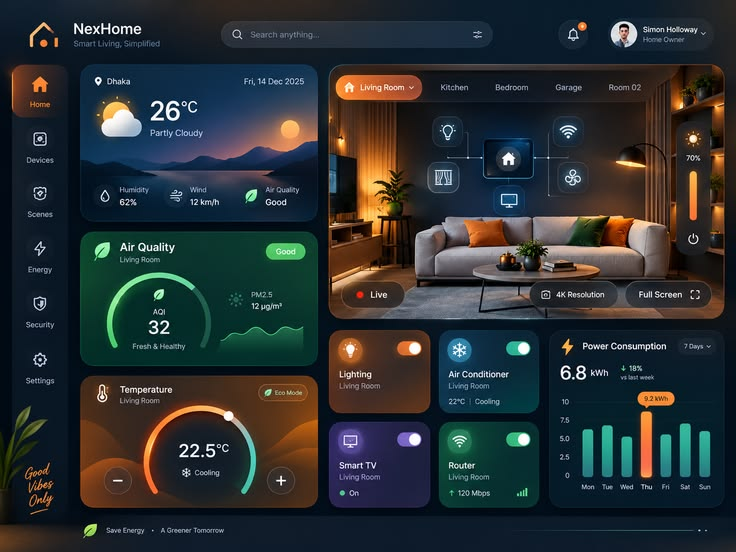

_Hearth Nest · original owner reference (`reference.jpg`; recreation `shot.jpg`, card `thumb.jpg`)._

A cinematic dark smart-home board: amber accent, living-room photo hero with device-node overlays, weather and AQI arc, thermostat dial, device toggles and a 7-day power chart.

- **Use cases:** Smart home & IoT · **Mode:** dark · **Mood:** cinematic, warm, cosy, premium, amber
- **Pages:** Overview (`overview`, Dashboard) · Rooms (`rooms`, List) · Devices (`devices`, List) · Energy (`energy`, Report) · Settings (`settings`, Settings)
- **Motion:** count-up, stagger, hover-lift, press, page-transition, ambient, skeleton, toast, icon-state
- **Signature:** Warm amber glow over a living-room camera still with sofa, lamp and plant, linked by glowing device constellation nodes.
- **Layout:** 64px icon rail · top bar (brand, search, bell, avatar) · left stack (weather, AQI arc + spark, thermostat dial) · right hero (room tabs, living-room photo with device nodes, vertical brightness) · bottom row (2×2 device toggles · 7-day power bars) · eco footer
- **Responsive:** ≤1180px: left stack and hero stack; power full width · ≤960px: rail becomes top icon strip · ≤640px: single column, room tabs scroll, brightness becomes horizontal
- **Fonts:** Syne / Outfit · **Palette:** bg `#12151c`, surface `#1a1f2a`, text `#f4ebe0`, muted `#b8aea2`, accent `#f0a04b`, aqi `#3ecf8e`, cool `#5b8def`, violet `#a78bfa`
- **Variants:** Amber hearth, Cedar, Frost · **Closest toolkit theme:** `ember`

**Best for**
- Consumer smart-home or HVAC brands that want atmosphere over grids
- In-home tablets and wall panels with a living-room hero
- Energy glance views paired with climate and lighting

**Avoid when**
- Dense device tables or installer tooling
- Light-mode-only brands
- Screens that cannot spare space for a scenic hero

**Components:** Icon rail navigation · Pill search and notification bell · Weather scene card with humidity/wind/AQI chips · AQI arc gauge with PM2.5 sparkline · Thermostat dial with ± and eco pill · Room segmented tabs · Living-room photo hero with device nodes · Vertical brightness slider · Device power toggle tiles · 7-day power bar chart

---

### 25. Forge Fitness

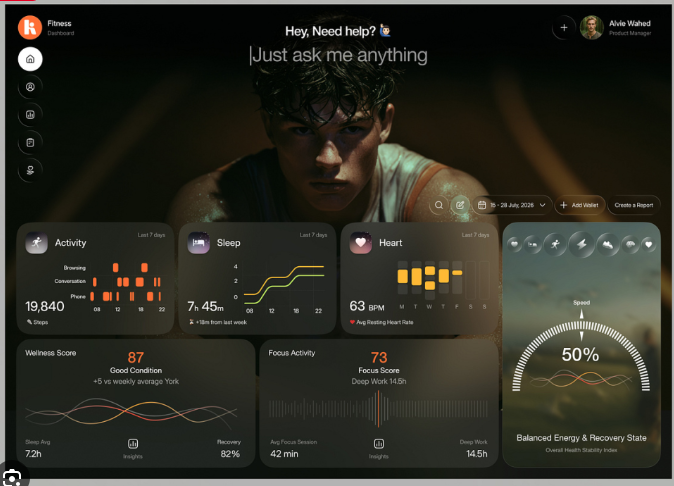

_Forge Fitness · original owner reference (`reference.png`; recreation `shot.jpg`, card `thumb.jpg`)._

A cinematic dark fitness board: frosted glass cards for steps, sleep, heart, wellness and focus float over an athlete gym photo atmosphere, with an energy-and-recovery gauge on the right.

- **Use cases:** Health & fitness · **Mode:** dark · **Mood:** cinematic, athletic, moody, focused, premium
- **Pages:** Overview (`overview`, Dashboard) · Activity (`activity`, Report) · Sessions (`sessions`, Calendar) · History (`history`, List) · Settings (`settings`, Settings)
- **Motion:** count-up, stagger, hover-lift, press, page-transition, ambient, skeleton, toast, icon-state
- **Signature:** Glass metric cards floating over an athlete gym photo with orange and lime accents.
- **Layout:** 64px icon rail · top bar (brand, ask-anything search, add, avatar) · toolbar (search, edit, date range, add wallet, create report) · 12-column glass grid: activity · sleep · heart · wellness + focus + tall energy/recovery gauge
- **Responsive:** ≤1180px: energy gauge drops below wellness/focus · ≤960px: icon rail becomes top chips, cards 2-col · ≤640px: single column, toolbar scrolls
- **Fonts:** Syne / Manrope · **Palette:** bg `#0c0d10`, surface `#1a1c24`, text `#f4f1ea`, muted `#d8d1c7`, accent `#ff6a2a`, lime `#c8f05a`, gold `#f5d76e`
- **Variants:** Forge, Ember, Ice · **Closest toolkit theme:** `ember`

**Best for**
- Wearables and consumer fitness apps with a dramatic brand
- Daily recovery overviews with a few bold scores
- Dark-mode health products that want glass over atmosphere

**Avoid when**
- Clinical or coach tools with dense athlete tables
- Brands that need a bright, clinical look
- Screens that must work without large decorative backgrounds

**Components:** Slim icon rail wired to multipage · Ask-anything search field · Date-range chip and report actions · Steps activity category grid · Dual-line sleep chart · Heart-rate barbell week bars · Wellness score with wave art · Focus soundwave meter · Energy recovery semi-gauge with metric pills · Athlete gym photo atmosphere

---

## Glass & glow

Frosted translucent panels over gradients or blurred color fields, soft glows. Modern, techy, premium.

### 7. Haven Listings

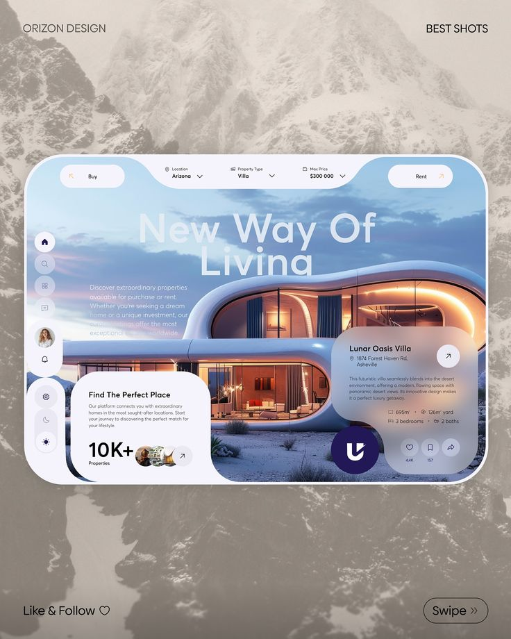

_Haven Listings · original owner reference (`reference.jpg`; recreation `shot.jpg`, card `thumb.jpg`)._

A property browser built around one large dusk villa photo: curved white architecture glows under a blue sky, white filter tabs notch into the top edge, and a frosted card shows the selected home.

- **Use cases:** Real estate · **Mode:** light · **Mood:** airy, premium, calm, architectural, soft
- **Pages:** Overview (`overview`, Dashboard) · Listings (`listings`, List) · Showings (`showings`, Calendar) · Settings (`settings`, Settings)
- **Motion:** count-up, stagger, hover-lift, press, page-transition, ambient, skeleton, toast, icon-state
- **Signature:** White tabs that notch into the rounded edge of a full-bleed dusk villa photo, where warm interior light spills from curved glass walls.
- **Layout:** 600px rounded stage with a full-bleed scene: top row (Buy pill, notched filter tab with 3 selects, Rent pill) · left 60px pill rail of 6 icons · headline and lede · white match-count card bottom-left · frosted detail card bottom-right (340px) · below: 3 cards (matching homes list, price-history line chart, viewings with a book button)
- **Responsive:** ≤1100px: detail card moves under the match card, lower cards 2 columns · ≤700px: single column, filters become a stacked white card, rail turns into a horizontal pill, scene stays behind the top 470px
- **Fonts:** Urbanist / Urbanist · **Palette:** bg `#ebe7e1`, surface `#f7f5f8`, text `#1d1b33`, muted `#55526b`, accent `#2a2470`, sky `#3f5a96`, glow `#e8743a`, rust `#c2562f`
- **Variants:** Dusk, Sunrise, Midnight · **Closest toolkit theme:** `tide`

**Best for**
- Real-estate, hospitality or travel products that sell one hero item at a time
- Browse-and-shortlist flows with a few filters
- Brands that want a showroom feeling rather than a data tool

**Avoid when**
- Agents managing hundreds of listings: there is no table or map
- Dense analytics: only one chart fits naturally
- Low-end devices where backdrop blur is costly (the card falls back to a near-opaque fill)

**Components:** Buy / Rent toggle pills · Notched filter tab with selects · Vertical icon rail in a pill · Match count card with step-through arrow · Frosted detail card with specs and save, compare, share · Selectable listing rows with photo thumbnails · Line chart with hover/focus values · Viewings list with date chips

---

### 8. Aura Ring

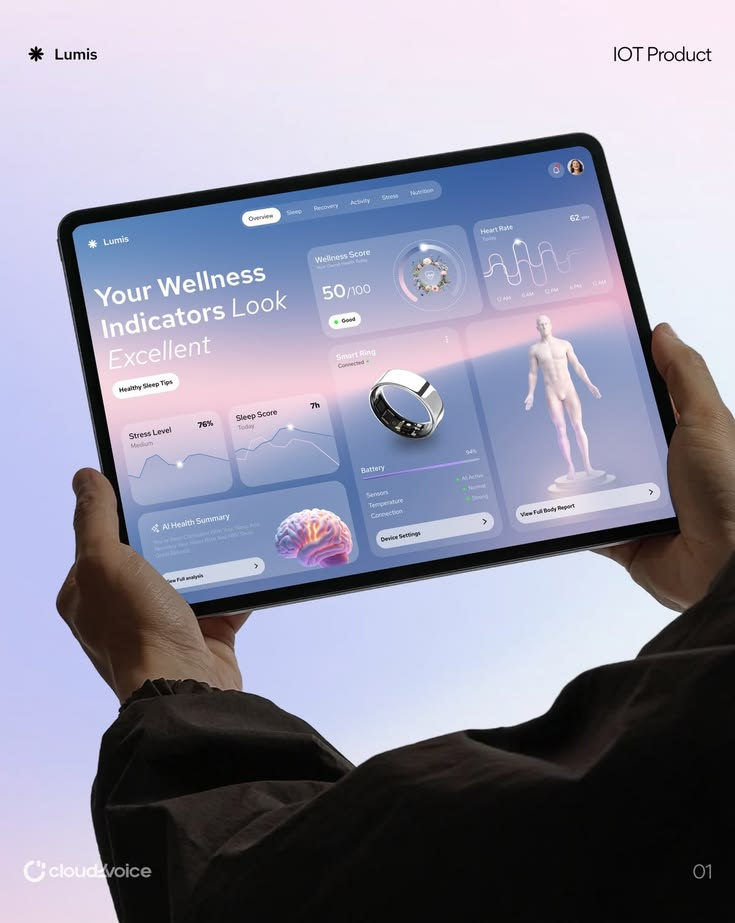

_Aura Ring · original owner reference (`reference.jpg`; recreation `shot.jpg`, card `thumb.jpg`)._

A wellness overview for a smart ring: frosted, softly bordered cards float over a periwinkle-to-pink haze, with a two-weight headline, a score dial, thin white line charts, a painted ring photo, a brain summary orb and a tappable body map — plus Vitals, Appointments, Records and Settings.

- **Use cases:** Health & fitness · **Mode:** dark · **Mood:** serene, dreamy, premium, soft, futuristic
- **Pages:** Overview (`overview`, Dashboard) · Vitals (`vitals`, Report) · Appointments (`appointments`, Calendar) · Records (`records`, List) · Settings (`settings`, Settings)
- **Motion:** count-up, stagger, hover-lift, press, page-transition, ambient, skeleton, toast, icon-state
- **Signature:** Frosted cards with a hairline white edge over a deep periwinkle field that blooms pink on the right, a painted metal ring and brain orb, and solid white pills as the only opaque elements.
- **Layout:** Top bar (brand, centred pill tabs, bell, avatar) · 12-column grid, 18px gaps: row 1 headline (5) + score card (4) + heart-rate card (3) · rows 2–3: two small chart cards and a summary card on the left (5), device card (4) and body-map card (3) spanning both rows
- **Responsive:** ≤1100px: 2 columns (headline, score + heart rate, stress + sleep, device + body, summary) and tabs scroll · ≤680px: single column, tabs on their own scrolling row
- **Fonts:** Red Hat Display / Red Hat Display · **Palette:** bg `#3f4f8f`, surface `#34417f`, text `#ffffff`, muted `#fafbff`, accent `#ffffff`, periwinkle `#6079c4`, pink `#ffc4dd`, lilac `#b9a4ff`, mint `#8ef0b4`
- **Variants:** Haze, Lagoon, Pearl · **Closest toolkit theme:** `aurora`

**Best for**
- Wearables, sleep, wellness and other consumer health products
- Tablet-first overviews with a few scores and one device
- Brands that want a calm, ambient feeling

**Avoid when**
- Clinical tools where precision and density matter more than mood
- Long tables or many KPIs
- Interfaces that must work without colour gradients (print, e-ink)

**Components:** Centred pill tabs that switch the score · Two-weight headline with tip chip · Score card with arc dial and state chip · Thin line charts with point markers · Device card with painted ring photo and battery bar · Body map with selectable points · Summary card with painted brain orb · White pill buttons with round arrow · Primary pages nav (Overview / Vitals / Appointments / Records / Settings)

---

### 14. Prism Workspace

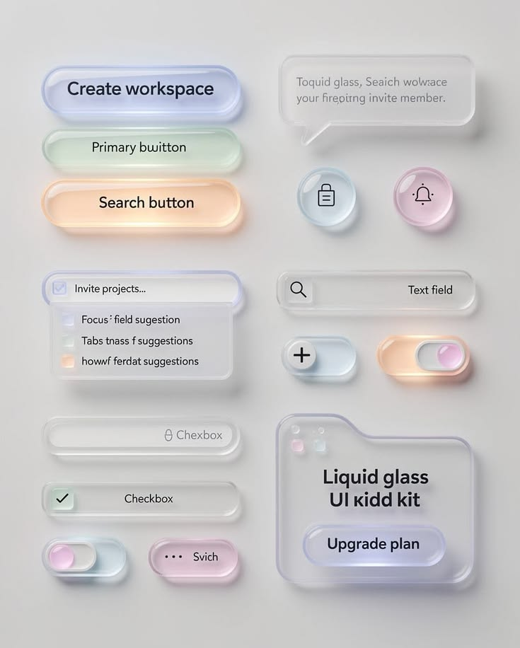

_Prism Workspace · original owner reference (`reference.jpg`; recreation `shot.jpg`, card `thumb.jpg`)._

Workspace settings in a light liquid-glass style: pastel blob photo atmosphere, thick translucent pills, a playful “Liquid glass UI kidd kit” strip with intentional misspell charm, invite suggestions, members, permissions, and a folder-shaped plan card.

- **Use cases:** SaaS admin · **Mode:** light · **Mood:** airy, polished, calm, modern, tactile
- **Pages:** Overview (`overview`, Dashboard) · Workspace (`workspace`, List) · People (`people`, List) · Settings (`settings`, Settings)
- **Motion:** count-up, stagger, hover-lift, press, page-transition, ambient, skeleton, toast, icon-state
- **Signature:** Thick liquid-glass pills and orbs over soft pastel photo blobs, plus a kit strip that keeps the reference’s misspell charm (Primary bwitton) beside real workspace copy.
- **Layout:** Top bar: gem wordmark, glass tab pill, lock and bell orbs · title row with Create workspace pill · 12-column grid: invite (4) + members (5) + folder plan card (3) · permissions (6) + notifications (6)
- **Responsive:** ≤1100px: 2 columns (invite + members, plan under invite, permissions and notifications full width) · ≤700px: single column, tabs scroll on their own row, permissions in one column
- **Fonts:** Inter Tight / Inter Tight · **Palette:** bg `#eceef3`, surface `#ffffff`, text `#1f2330`, muted `#525a6c`, accent `#4f4fb0`, lilac `#d9dcff`, mint `#cdeedd`, peach `#ffdcc4`
- **Variants:** Opal, Aqua, Obsidian · **Closest toolkit theme:** `aurora`

**Best for**
- Settings and admin pages for team or collaboration tools
- Products that want an Apple-like glass look without hurting readability
- Onboarding steps such as inviting a team

**Avoid when**
- Data-dense screens or tables
- Low-end devices where backdrop blur is costly
- Brands that want flat or high-contrast UI

**Components:** Glass tab bar and icon orbs · Invite combobox with suggestions (arrow keys, Enter, Esc) · Role radio group · Member list with filter and remove · Permission checkboxes · Notification switches · Folder-shaped plan card with seat meter · Speech-bubble tip · Pastel blob photo atmosphere · Liquid glass UI kidd kit strip · Workspace / People / Settings multipage views

---

### 19. Veil Rooms

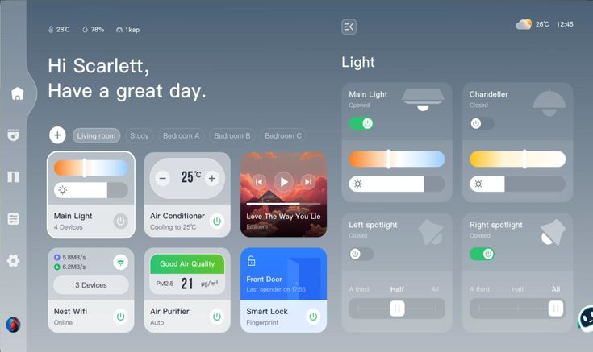

_Veil Rooms · original owner reference (`reference.jpg`; recreation `shot.jpg`, card `thumb.jpg`)._

A grey smart-home board: greeting and room pills, a 2×3 grid of opaque device cards with album art, and a right Light panel for fixture toggles and stepped spotlights.

- **Use cases:** Smart home & IoT · **Mode:** dark · **Mood:** glassy, calm, modern, cool, precise
- **Pages:** Overview (`overview`, Dashboard) · Rooms (`rooms`, List) · Devices (`devices`, List) · Energy (`energy`, Report) · Settings (`settings`, Settings)
- **Motion:** count-up, stagger, hover-lift, press, page-transition, ambient, skeleton, toast, icon-state
- **Signature:** Opaque grey device cards beside a dedicated Light fixtures column with green on-toggles and three-step spotlight rails, plus painted album art.
- **Layout:** 56px icon rail · centre column (status chips, greeting, room pills, 3×2 device cards) · 320px right Light panel (header, time, 2×2 fixture cards with toggles and sliders)
- **Responsive:** ≤1180px: Light panel drops under the device grid · ≤960px: rail becomes a top strip · ≤640px: device cards single column, room pills scroll
- **Fonts:** Plus Jakarta Sans / Plus Jakarta Sans · **Palette:** bg `#1a1d24`, surface `#2a2e38`, text `#f2f4f8`, muted `#b4bac4`, accent `#6ecf9a`, cool `#5b9cf0`, warm `#f0b35a`, glass `#343944`
- **Variants:** Slate glass, Mist, Midnight · **Closest toolkit theme:** `noir`

**Best for**
- Apartment or multi-room lighting-first control apps
- Tablet dashboards that keep climate and media beside lights
- Brands that want frosted glass without a scenic photo hero

**Avoid when**
- Energy analytics that need large charts
- Installer or device-fleet admin screens
- Brands that require a warm cinematic look

**Components:** Slim icon rail with avatar wired to multipage · Environment status chips · Personal greeting · Room pill switcher with add · Main light dual sliders · AC temperature stepper · Media player card with album photo · Wifi speed card · Air purifier status card · Smart lock card · Right Light fixtures panel with stepped spotlight control

---

### 20. Atrium Living

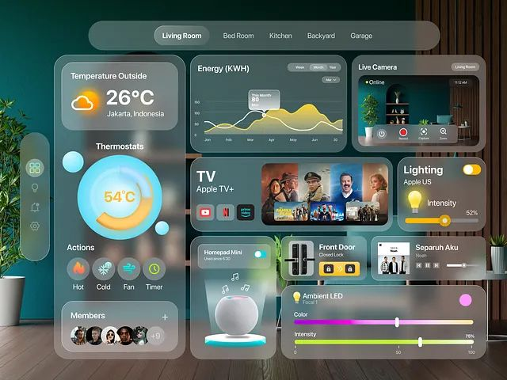

_Atrium Living · original owner reference (`reference.jpg`; recreation `shot.jpg`, card `thumb.jpg`)._

A glass smart-home room console over a living-room photo: climate dial, energy wave, live camera feed, door lock, lighting, music and ambient LED on frosted panels.

- **Use cases:** Smart home & IoT · **Mode:** light · **Mood:** airy, glassy, calm, contemporary, residential
- **Pages:** Overview (`overview`, Dashboard) · Rooms (`rooms`, List) · Devices (`devices`, List) · Energy (`energy`, Report) · Settings (`settings`, Settings)
- **Motion:** count-up, stagger, hover-lift, press, page-transition, ambient, skeleton, toast, icon-state
- **Signature:** Frosted glass panels floating over a teal-wall living-room still — tall window light, wood floor and plants — with a warm energy chart and cool climate dial as twin accents.
- **Layout:** Full-bleed SVG room backdrop · left pill icon rail · top room capsule nav · glass grid: climate column (weather, thermo dial, modes, members) · center (energy chart, TV strip, music) · right (camera, lighting, lock, ambient LED, speaker)
- **Responsive:** ≤1180px: rail becomes top icon strip, glass grid 2 columns · ≤960px: single column stack, backdrop shortens · ≤640px: room pills scroll horizontally, sliders full width, tap targets ≥44px
- **Fonts:** Sora / Manrope · **Palette:** bg `#d8e6ea`, surface `#f4f9fb`, text `#0f1c24`, muted `#3f515c`, accent `#f5b942`, cool `#4ec3d9`, pink `#ff6bb5`, wood `#c48a4a`
- **Variants:** Daylight, Dusk, Night · **Closest toolkit theme:** `coastal`

**Best for**
- Room-centric smart-home consoles with climate, security and media together
- Glassmorphism demos that need a real room backdrop without stock photos
- Light-mode gallery entries that still read premium

**Avoid when**
- Multi-home fleet monitoring or dense device inventories
- Brands that need opaque cards or a dark cinematic mood
- Screens where frost/blur would hide critical dense tables

**Components:** Vertical icon rail · Room capsule nav · Weather chip · Thermostat dial with climate modes · Members avatar row · Energy area chart with range seg · Live camera photo with controls · Lighting toggle and intensity slider · Door lock switch · Music transport · Ambient LED color and intensity · Smart speaker tile

---

### 24. Aether Pane

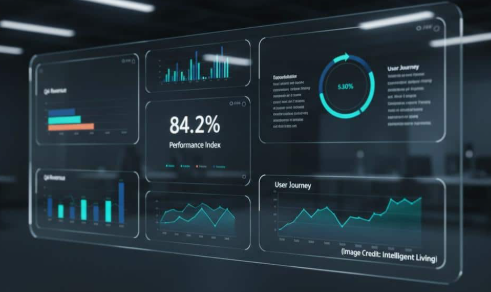

_Aether Pane · original owner reference (`reference.png`; recreation `shot.jpg`, card `thumb.jpg`)._

A dark cyan glass analytics HUD floating over a blurred office scene: Q4 revenue bars, a bold performance index, user-journey donut and neon area charts with soft frosted borders.

- **Use cases:** Analytics & BI, SaaS admin · **Mode:** dark · **Mood:** futuristic, glassy, neon, precise, calm-tech
- **Pages:** Overview (`overview`, Dashboard) · Reports (`reports`, Report) · Segments (`segments`, List) · Settings (`settings`, Settings)
- **Motion:** count-up, stagger, hover-lift, press, page-transition, ambient, skeleton, toast, icon-state
- **Signature:** One frosted cyan glass pane floating over a blurred office field, centered on a huge 84.2% Performance Index with neon chart glow.
- **Layout:** Centered floating glass shell · 3×2 module grid (horizontal revenue · spark + performance hero · journey donut / vertical revenue · dual area · large journey area)
- **Responsive:** ≤1180px: 2-column modules · ≤960px: single column inside the pane · ≤640px: pane edge-to-edge, charts shorten
- **Fonts:** Syne / IBM Plex Sans · **Palette:** bg `#061018`, surface `#0a1c28`, text `#e8f7ff`, muted `#7aa8b8`, accent `#00f0ff`, teal `#1a6a9a`, coral `#ff6b4a`, deep `#0d3a55`
- **Variants:** Cyan, Violet, Daylight · **Closest toolkit theme:** `tide`

**Best for**
- SaaS analytics overviews that want a HUD feel
- Executive glance boards with a few strong charts
- Dark glass demos where the pane itself is the hero

**Avoid when**
- Dense tables or CRUD admin work
- Brands that already use a competing glass workspace look
- Print or low-contrast environments

**Components:** Floating glass shell · Horizontal revenue bars · Vertical revenue bars · Spark bar strip · Performance index hero · Status dots · User journey donut · Dual and single area charts

---

### 28. Mauve Ledger

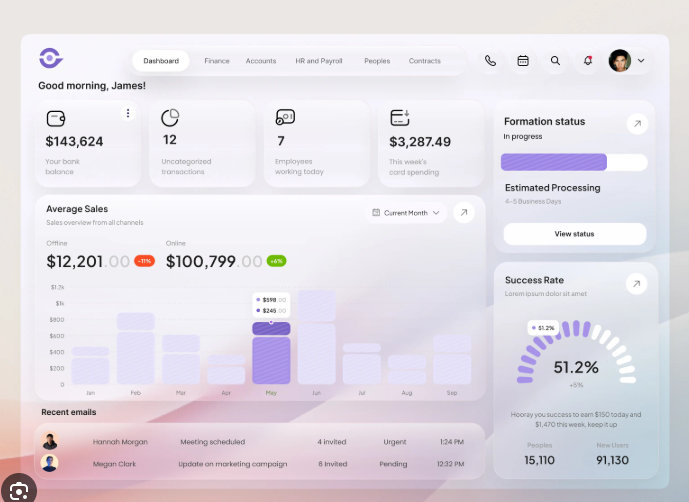

_Mauve Ledger · original owner reference (`reference.png`; recreation `shot.jpg`, card `thumb.jpg`)._

A light lilac glass finance desk: frosted KPI tiles over a soft lavender haze, average sales bars, formation status, a segmented success gauge and a recent-email list.

- **Use cases:** Finance & banking · **Mode:** light · **Mood:** airy, soft, premium, calm, lilac
- **Pages:** Overview (`overview`, Dashboard) · Transactions (`transactions`, List) · Budgets (`budgets`, Report) · Settings (`settings`, Settings)
- **Motion:** _none yet_
- **Signature:** Frosted lilac glass cards on a soft lavender–pink haze, anchored by a segmented 51.2% success gauge.
- **Layout:** Top bar (logo, pill nav, utility icons, avatar) · greeting · 4 KPI glass cards · 12-col: average sales (8) + formation status + success gauge (4) · recent emails full width
- **Responsive:** ≤1180px: KPIs 2×2, sales full width above side stack · ≤960px: nav scrolls · ≤640px: single column, email rows compact
- **Fonts:** Fraunces / Outfit · **Palette:** bg `#ddd6f3`, surface `#f7f4ff`, text `#2a2740`, muted `#6e6890`, accent `#6a58c8`, good `#16a34a`, bad `#dc2626`, haze `#c4b5fd`
- **Variants:** Lilac, Blush, Slate · **Closest toolkit theme:** `blush`

**Best for**
- Small-business finance overviews
- Founder dashboards that mix money KPIs with ops status
- Brands that want glassmorphism without going dark

**Avoid when**
- Payroll-first HR tools with illustrated night scenes (see Kumo Payroll)
- Dense general ledgers or multi-entity books
- Interfaces that must work without translucent surfaces

**Components:** Pill top navigation · Greeting headline · Four frosted KPI cards · Average sales bar chart with channel deltas · Formation status progress · Segmented success gauge · Recent email list with urgency

---

### 34. Saffron Dusk

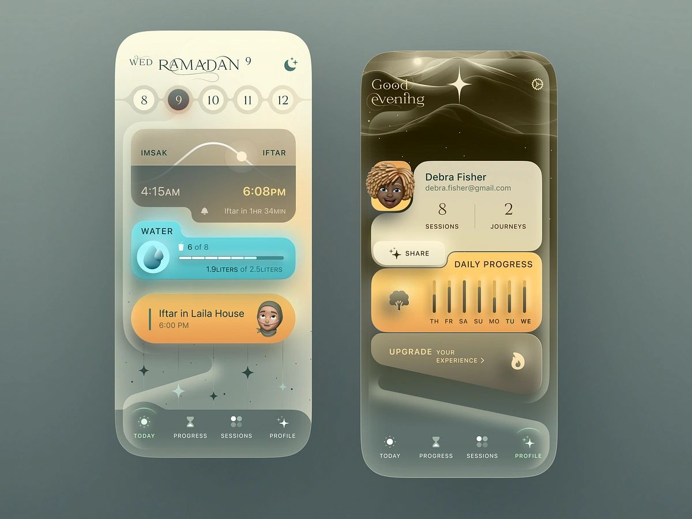

_Saffron Dusk · original owner reference (`reference.jpg`; recreation `shot.jpg`, card `thumb.jpg`)._

A respectful fictional fasting-day wellness board in liquid glass: twin phones with a date strip, imsak→iftar sun arc, water segments, an evening gather card, plus a glass profile, daily progress bars and an upgrade row.

- **Use cases:** Health & fitness, Education · **Mode:** light · **Mood:** serene, warm, reverent, airy, soft
- **Pages:** Overview (`overview`, Dashboard) · Vitals (`vitals`, Report) · Appointments (`appointments`, Calendar) · Records (`records`, List) · Settings (`settings`, Settings)
- **Motion:** _none yet_
- **Signature:** Frosted cream and olive glass phones with a white fasting sun arc, teal water segments and warm saffron gather/progress panels under Fraunces headlines.
- **Layout:** Stage · twin phones: Today (date strip, sun-arc card, water, gather, nav) · Profile (greeting, profile card, daily bars, upgrade, nav)
- **Responsive:** ≤1100px: phones stack · ≤700px: single column, date strip scrolls inside its row, nav stays sticky to each phone
- **Fonts:** Fraunces / Plus Jakarta Sans · **Palette:** bg `#e8efe8`, surface `#f4f7f2`, text `#1a2a24`, muted `#4a5c54`, accent `#c4783a`, teal `#2f6f6a`, olive `#3a4a38`, saffron `#e8a85a`
- **Variants:** Dusk, Dawn, Night · **Closest toolkit theme:** `coastal`

**Best for**
- Health and education apps around daily ritual or wellness habits
- Phone-first glass concepts shown as twin panels on desktop
- Brands that want serif display type with calm frosted cards

**Avoid when**
- Clinical EMR or dense medical charts
- Brands that forbid glass blur or serif display
- Low-end devices where backdrop-filter is costly

**Components:** Twin glass phone shells · Horizontal date strip · Imsak→iftar sun arc card · Water tracker with tappable segments · Evening gather card with silhouette avatar · Glass profile card with share action · Daily progress bar chart · Upgrade row · Glass bottom navigation

---

### 35. Clima Pane

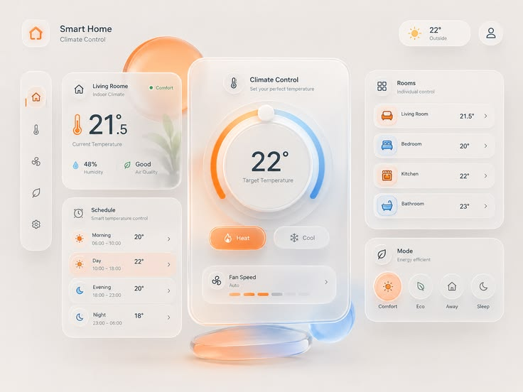

_Clima Pane · original owner reference (`reference.jpg`; recreation `shot.jpg`, card `thumb.jpg`)._

A light glass climate console on a beige field with soft orange and blue orb blobs: orange↔blue thermostat dial, Heat/Cool, fan speed bars, living-room stats, schedule, rooms list and energy mode chips.

- **Use cases:** Smart home & IoT · **Mode:** light · **Mood:** airy, warm, frosted, calm, tactile
- **Pages:** Overview (`overview`, Dashboard) · Rooms (`rooms`, List) · Devices (`devices`, List) · Energy (`energy`, Report) · Settings (`settings`, Settings)
- **Motion:** _none yet_
- **Signature:** Frosted glass cards floating over a beige canvas with soft orange and blue CSS orb blobs, centered on an orange↔blue thermostat dial.
- **Layout:** Floating glass icon rail · top brand + outside chip + avatar · left: living-room stats + schedule · center: climate dial with Heat/Cool and fan bars · right: rooms list + mode chips
- **Responsive:** ≤1180px: rooms and modes drop under dial · ≤960px: rail becomes top icon strip · ≤640px: single column, lists scroll inside cards
- **Fonts:** Sora / Manrope · **Palette:** bg `#ebe4d8`, surface `#ffffff`, text `#1c1916`, muted `#5c564e`, accent `#ff8c42`, cool `#4aa3e8`, ok `#186040`
- **Variants:** Amber pane, Sky, Dusk · **Closest toolkit theme:** `linen`

**Best for**
- HVAC and smart-thermostat companion apps
- Tablet wall panels focused on climate rather than every device
- Brands that want frosted glass over a warm beige field

**Avoid when**
- Full multi-device home consoles with cameras and media
- Dark cinematic living-room heroes
- Dense energy analytics tables

**Components:** Floating glass icon rail · Outside temperature chip · Living-room comfort stats card · Orange-to-blue thermostat dial with ± · Heat and Cool mode pills · Fan speed segmented bars · Schedule list with active period · Rooms list with chevrons · Circular Comfort/Eco/Away/Sleep chips

---

### 37. Cortex Well

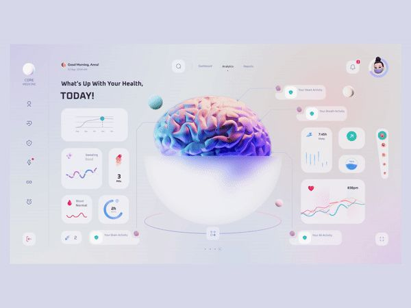

_Cortex Well · original owner reference (`reference.jpg`; recreation `shot.jpg`, card `thumb.jpg`)._

A lilac-glass wellness overview: frosted cards float over a soft pink–lilac haze around a painted brain in a glass bowl, with lead lines to Heart, Breath, Brain and All activity pills, sleep bars and a multi-line heart chart.

- **Use cases:** Health & fitness · **Mode:** light · **Mood:** ethereal, soft, calm, premium, lilac
- **Pages:** Dashboard (`overview`, Dashboard) · Analytics (`analytics`, Report) · Reports (`reports`, Report)
- **Motion:** count-up, stagger, hover-lift, press, page-transition, ambient, skeleton, toast, icon-state
- **Signature:** A painted brain in a frosted glass bowl at center stage, with glass activity pills on lead lines and soft floating orbs.
- **Layout:** 64px icon rail · top (greeting, glass pill nav, bell, avatar) · headline · 12-column board: left stack (performance, sleep waves, 3 metric tiles) · centre brain bowl with activity pills · right stack (sleep bars, heart bpm) · footer dots
- **Responsive:** ≤1180px: rail becomes a top strip; board stacks left → hero → right · ≤960px: metric tiles 3-up · ≤640px: single column, nav scrolls, pills wrap
- **Fonts:** Plus Jakarta Sans / Plus Jakarta Sans · **Palette:** bg `#e8dff5`, surface `#f7f2fc`, text `#2a2438`, muted `#6a5f7a`, accent `#5f4fb0`, pink `#f2a0c0`, teal `#5ec4b0`, heart `#e85a6b`
- **Variants:** Lilac haze, Rose mist, Dusk violet · **Closest toolkit theme:** `blush`

**Best for**
- Consumer wellness or mental-fitness products that want a gentle glass look
- Tablet overviews centred on one signature illustration
- Brands that prefer pastel lilac/pink over clinical blue or lime

**Avoid when**
- Clinical EHR or dense lab tables
- Dark-mode-only brands
- Screens that cannot spare space for a hero illustration

**Components:** Icon rail navigation · Glass top bar with Dashboard / Analytics / Reports · Painted brain-in-bowl hero · Floating pastel orbs · Activity focus pills with lead lines · Performance and sleep wave cards · Sleep bar chart and multi-line heart rate · Analytics and Reports pages with states

---

## Minimal & airy

Lots of white space, hairlines, one accent, quiet type. Calm tools people use all day.

### 13. Taffy Analytics

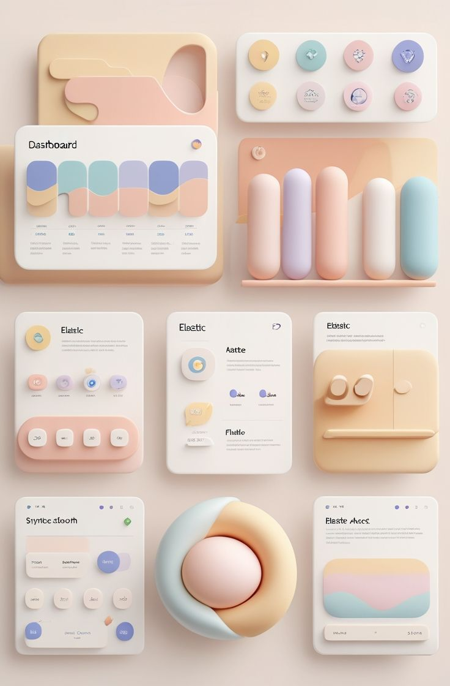

_Taffy Analytics · original owner reference (`reference.jpg`; recreation `shot.jpg`, card `thumb.jpg`)._

A calm pastel product-analytics dashboard for a design-tool startup: a rounded-sans headline number over a soft area chart, dual-tone clay capsules for sign-ups by channel, a plan-mix ring with a clay sphere prop, springy feature-flag switches and a release checklist — plus Workspace, People and Settings.

- **Use cases:** SaaS admin, Analytics & BI · **Mode:** light · **Mood:** calm, tactile, light, friendly, modern
- **Pages:** Overview (`overview`, Dashboard) · Workspace (`workspace`, List) · People (`people`, List) · Settings (`settings`, Settings)
- **Motion:** count-up, stagger, hover-lift, press, page-transition, ambient, skeleton, toast, icon-state
- **Signature:** Dual-tone pastel clay capsules standing on a peach shelf, with a soft interlocking sphere prop and rounded sans titles matching the kit.
- **Layout:** Top bar: serif wordmark, centred pill of 5 round workspace buttons, avatar · 12-column grid: weekly active teams area chart (7) + capsule chart (5, two rows) · KPI strip (7) · plan mix (4) + feature flags (4) + release checklist (4)
- **Responsive:** ≤1100px: 2 columns (hero and KPIs full width, capsules + mix, flags + checklist) · ≤700px: single column, workspace pill on its own row, KPIs stacked
- **Fonts:** Manrope / Manrope · **Palette:** bg `#f4ebe4`, surface `#fbf8f5`, text `#2e2633`, muted `#5a5160`, accent `#5d55b8`, peach `#f3c3ae`, lilac `#c9c2ee`, mint `#b9e0dd`
- **Variants:** Taffy, Mint, Dusk · **Closest toolkit theme:** `blush`

**Best for**
- Product and growth overviews for small SaaS teams
- Internal admin pages with flags and checklists
- Brands that want soft, tactile charts instead of hard lines

**Avoid when**
- Dense reporting with many series
- Finance or ops tools that need exact gridlines
- Dark, technical brands

**Components:** Round workspace switcher and pages nav · Headline number with area chart and range toggle · Dual-tone clay capsule chart with peach shelf · KPI strip with dividers · Rounded donut ring with clay sphere prop · Feature-flag list with springy switches and filter · Checklist with progress bar

---

## Bento grid

Tiles of different sizes in a tight grid, each tile one idea. Great for overviews and product showcases.

### 11. Vitalis Care

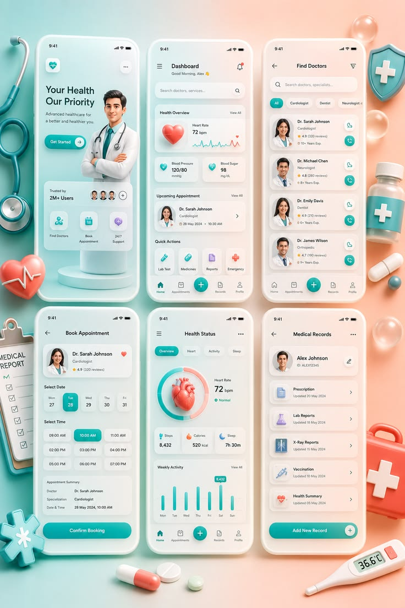

_Vitalis Care · original owner reference (`reference.jpg`; recreation `shot.jpg`, card `thumb.jpg`)._

A bento-grid patient dashboard for a family clinic: clay doctor hero photo, dimensional heart, floating medical props, tinted vital tiles, teal next-appointment card, doctor directory with booking, activity chart, quick actions, and Vitals / Appointments / Records / Settings pages.

- **Use cases:** Health & fitness · **Mode:** light · **Mood:** clear, caring, organised, fresh, friendly
- **Pages:** Overview (`overview`, Dashboard) · Vitals (`vitals`, Report) · Appointments (`appointments`, Calendar) · Records (`records`, List) · Settings (`settings`, Settings)
- **Motion:** count-up, stagger, chart-draw, hover-lift, press, page-transition, ambient, skeleton, toast, icon-state
- **Signature:** A clay doctor hero beside the greeting, floating medical props at the stage edges, and a glossy dimensional heart with a coral pulse trace in a tight bento of tinted tiles.
- **Layout:** Pill top bar (brand, 4 links, bell, avatar) · greeting row · 12-column bento: heart rate (4) + blood pressure (2) + blood sugar (2) + next appointment (4) · doctor directory (5, two rows) + booking (4, two rows) + this week chart (3) + records (3)
- **Responsive:** ≤1100px: 4-column bento (vitals pair, directory + booking side by side) · ≤700px: 2-column bento with vitals side by side, everything else full width, nav on its own row
- **Fonts:** Plus Jakarta Sans / Plus Jakarta Sans · **Palette:** bg `#eef7f5`, surface `#ffffff`, text `#12332f`, muted `#466361`, accent `#0b7268`, chart `#14a092`, coral `#b83a30`, coral_soft `#fde8e4`
- **Variants:** Teal, Sage, Night · **Closest toolkit theme:** `coastal`

**Best for**
- Clinics, telehealth and family-health apps
- Portals that join a directory to booking
- Overviews that mix live readings with tasks

**Avoid when**
- Hospital staff tools with many patients
- Pages that need one dominant chart
- Brands that want a dark or dramatic look

**Components:** Pill top bar with notification dot · Clay doctor hero image · Floating medical props (stethoscope, pills, thermometer, kit) · Vital tiles in tinted colours · Heart-rate tile with clay heart photo and pulse trace · Hero search synced to doctor directory · Next-appointment tile · Quick-action clay buttons · Doctor directory with search, chips, call and book · Week strip, time grid and booking summary · Steps / sleep bar chart toggle · Records list with add action · Vitals / Appointments / Records / Settings pages

---

### 17. Larchwood Lodge

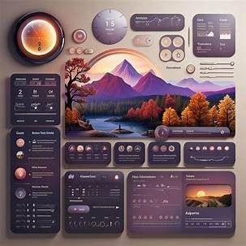

_Larchwood Lodge · original owner reference (`reference.jpg`; recreation `shot.jpg`, card `thumb.jpg`)._

A dusky plum glass bento guest hub for a mountain cabin. A painted autumn lake at sunset greets the family. Around it sit frosted tiles for cabin heat, daylight left, a five-day forecast, light scenes, activity booking, wake-up alarms and today's trail status — plus Rooms, Guests and Settings.

- **Use cases:** Hospitality & food, Smart home & IoT · **Mode:** dark · **Mood:** cosy, warm, seasonal, calm, atmospheric
- **Pages:** Overview (`overview`, Dashboard) · Rooms (`rooms`, List) · Guests (`guests`, List) · Settings (`settings`, Settings)
- **Motion:** count-up, stagger, hover-lift, press, page-transition, ambient, skeleton, toast, icon-state
- **Signature:** A painted autumn lake at sunset (plum ridges, gold and rust larches) set inside frosted plum glass bento tiles that pick up the same sunset orange.
- **Layout:** Top bar: mark, name, stay dates · 12-column bento: landscape hero with greeting (8) + thermostat dial (4) · daylight arc (3) + forecast (5) + light scenes (4) · activity booking (6) + alarms (3) + trails (3)
- **Responsive:** ≤1100px: 2 columns (hero full, dial + daylight, forecast full, scenes + alarms, bookings and trails full) · ≤700px: single column, greeting moves under the art
- **Fonts:** Fraunces / Figtree · **Palette:** bg `#1c1720`, surface `#2a2230`, text `#f5eef3`, muted `#e4d6e0`, accent `#f29455`, sky `#a65a6a`, larch `#f0a03c`, lake `#3a4a6b`
- **Variants:** Plum, Birch, Pine · **Closest toolkit theme:** `ember`

**Best for**
- Guest apps for cabins, boutique hotels and holiday rentals
- In-room tablets that mix comfort controls with local info
- Seasonal brands that want a scenic hero

**Avoid when**
- Back-office hotel management with dense tables
- Bright, high-energy brands
- Screens that must show many rooms at once

**Components:** Painted lake photo hero with greeting glass card · Thermostat dial with step buttons · Daylight arc · Five-day forecast picker · Light-scene radio tiles · Activity booking list with filter and empty state · Alarm switches · Trail status list · Primary pages nav (Overview / Rooms / Guests / Settings)

---

### 27. Orchard Sales

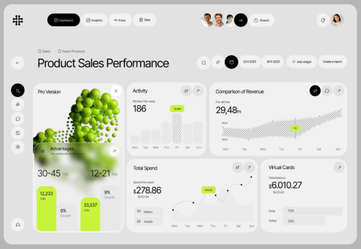

_Orchard Sales · original owner reference (`reference.png`; recreation `shot.jpg`, card `thumb.jpg`)._

A light black-and-lime sales bento: slim icon rail, pill nav, a tall product hero with sphere art and frosted advantages, activity bars, hatched revenue area, spend line and virtual-card balances.

- **Use cases:** CRM & sales, Analytics & BI · **Mode:** light · **Mood:** crisp, modern, commercial, bright, precise
- **Pages:** Overview (`overview`, Dashboard) · Pipeline (`pipeline`, Board) · Accounts (`accounts`, List) · Settings (`settings`, Settings)
- **Motion:** _none yet_
- **Signature:** A tall product tile with a lime sphere cluster, frosted advantages glass, and thick lime growth bars.
- **Layout:** 56px dark icon rail · top bar with pill nav and avatars · breadcrumb + title + date/actions · 12-col bento: product hero (3, tall) · activity (5) · revenue (4) · spend (5) · virtual cards (4)
- **Responsive:** ≤1180px: rail becomes bottom or top chips · ≤960px: product full width, charts 2-col · ≤640px: single column, action chips scroll
- **Fonts:** Sora / IBM Plex Sans · **Palette:** bg `#eceff1`, surface `#ffffff`, text `#0f1110`, muted `#3f4742`, accent `#c6f000`, ink `#141414`, rail `#171917`, hatch `#d5d9d6`
- **Variants:** Orchard, Citrus, Graphite · **Closest toolkit theme:** `atelier`

**Best for**
- Sales or product-performance overviews
- CRM analytics with a bold lime brand
- Bento layouts that mix a hero tile with a few charts

**Avoid when**
- Dense opportunity pipelines or editable deal tables
- Health or wellness products (use Zest Health instead)
- Brands that need soft pastels instead of high-contrast lime

**Components:** Slim dark icon rail · Pill navigation · Avatar stack and share · Date range chips · Product hero with sphere SVG and glass advantages · Weekly activity bar chart · Hatched revenue area chart · Spend line chart · Virtual card progress bars

---

## Data-dense pro

Compact tables, many small charts, tight spacing, monospace numbers. Trading, ops, analytics power users.

### 21. Glacier Ops

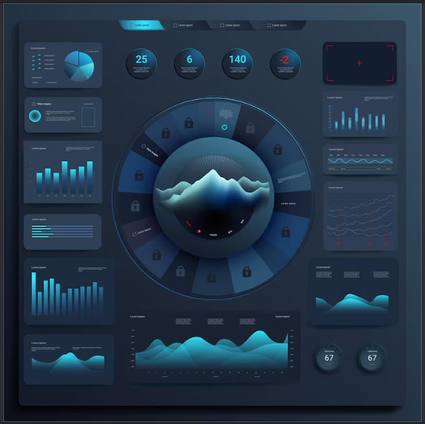

_Glacier Ops · original owner reference (`reference.png`; recreation `shot.jpg`, card `thumb.jpg`)._

A data-dense dark-blue radial HUD for cold-ops monitoring: a multi-ring dial with SVG glacier topography, cyan accents, and a ring of compact charts, gauges and a viewfinder.

- **Use cases:** Analytics & BI · **Mode:** dark · **Mood:** tactical, icy, technical, dense, nocturnal
- **Pages:** Overview (`overview`, Dashboard) · Reports (`reports`, Report) · Segments (`segments`, List) · Settings (`settings`, Settings)
- **Motion:** _none yet_
- **Signature:** A cyan-rimmed multi-ring dial whose core is a hand-drawn glacier topographic sphere, ringed by lock segments and flanked by dense miniature charts.
- **Layout:** Top bar (brand, sector tabs, 4 status orbs) · 12-column body: left chart stack · center multi-ring topo dial · right viewfinder + lines + dual gauges · full-width bottom area wave
- **Responsive:** ≤1180px: dial full width on top, side stacks become two columns below · ≤960px: single column, dial scales down, bottom chart first after dial · ≤640px: status orbs wrap, tabs scroll
- **Fonts:** Rajdhani / IBM Plex Sans · **Palette:** bg `#070d18`, surface `#0f1a2c`, text `#d7f4ff`, muted `#7fa8bf`, accent `#3de0ff`, alert `#ff4d6a`, panel `#1a3350`
- **Variants:** Glacier, Cobalt, Night · **Closest toolkit theme:** `midnight`

**Best for**
- Operations or telemetry walls that need a heroic central radial
- Cyan-on-navy analytical showcases
- Dashboards where many small charts surround one signature dial

**Avoid when**
- Simple consumer apps or sparse KPI boards
- Light-mode brand systems
- Editable record workflows — this screen is for monitoring, not forms

**Components:** Sector tab nav · Status orbs · Multi-ring radial dial with SVG topo · Lock segment ring · Donut breakdown · Vertical bar mini-charts · Horizontal progress meters · Spark / area waves · Multi-line series · Viewfinder frame · Dual arc gauges · Bottom range area chart

---

### 23. Citadel Wall

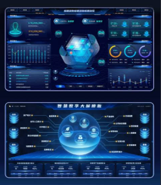

_Citadel Wall · original owner reference (`reference.png`; recreation `shot.jpg`, card `thumb.jpg`)._

A navy big-screen ops wall with cyan glow: bracketed KPI panels, a central holographic cube core, arc gauges, dense charts and a four-block spark footer for fictional orbital logistics — with Fleet, Shipments and Settings pages.

- **Use cases:** Analytics & BI, Logistics & fleet · **Mode:** dark · **Mood:** tactical, glowing, dense, command-center, futuristic
- **Pages:** Overview (`overview`, Dashboard) · Fleet (`fleet`, List) · Shipments (`shipments`, Board) · Settings (`settings`, Settings)
- **Motion:** count-up, stagger, chart-draw, hover-lift, press, page-transition, ambient, skeleton, toast
- **Signature:** A cyan-glow cube locked inside a translucent sphere on a scan-line pedestal, framed by HUD brackets on a deep navy wall.
- **Layout:** Tech title bar · three columns (left identity/charts/status · center hologram · right KPI grid/gauges/bars) · bottom four-metric spark strip
- **Responsive:** ≤1180px: hologram on top, side columns two-up below · ≤960px: single column stacks · ≤640px: gauges wrap, footer 2×2
- **Fonts:** Share Tech Mono / Exo 2 · **Palette:** bg `#050b18`, surface `#0a1528`, text `#d8f4ff`, muted `#7aa8c4`, accent `#00e5ff`, blue `#3a9fff`, warn `#ff9f43`, ok `#7dffb3`
- **Variants:** Cyan, Ocean, Amber · **Closest toolkit theme:** `midnight`

**Best for**
- Control-room or wall displays for logistics and ops
- Demo HUDs that need a sci-fi big-screen feel
- Dashboards where a central 3D-ish focal point carries the brand

**Avoid when**
- Consumer apps or soft education products
- Light themes as the primary look
- Editing workflows — this is monitor-first, not form-first

**Components:** Tech-frame header · Nav tabs · Identity panel · Line and bar charts · Status list · 2×2 KPI tiles · Arc gauges · Hologram cube photo + HUD rings · Bottom spark strip

---

## Soft & friendly

Rounded shapes, pastel fills, playful illustration-free warmth. Health, education, personal apps.

### 5. Canopy Reforest

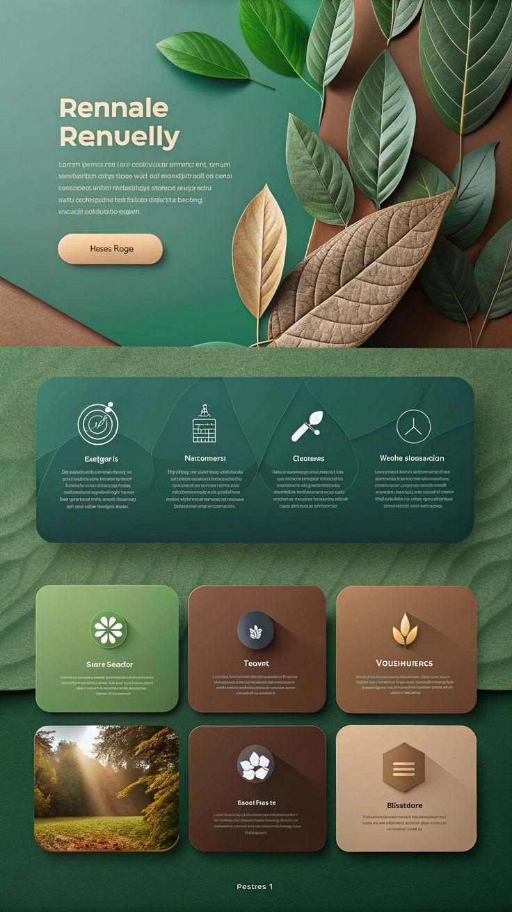

_Canopy Reforest · original owner reference (`reference.jpg`; recreation `shot.jpg`, card `thumb.jpg`)._

An organic reforestation tracker in forest green, bark brown and tan: a leafy photo hero with a rounded headline, a deep green band of four site figures and six soft, colour-blocked tiles for species, planting, soil, forest scene, tasks and crews — plus Tasks, Sites and Settings pages.

- **Use cases:** Projects & tasks, Analytics & BI · **Mode:** dark · **Mood:** organic, calm, earthy, friendly, soft
- **Pages:** Overview (`overview`, Dashboard) · Tasks (`tasks`, Board) · Sites (`sites`, List) · Settings (`settings`, Settings)
- **Motion:** count-up, stagger, chart-draw, hover-lift, press, page-transition, ambient, skeleton, toast, icon-state
- **Signature:** Overlapping green and tan leaves with fine veins, drawn from one SVG path, spilling over a bark-brown wedge in the hero.
- **Layout:** Centred 1240px column · top bar · diagonal hero (copy left, leaf photo right) · 4-column metrics band · 3×2 colour tiles including forest photo
- **Responsive:** ≤980px tiles 2 columns · ≤640px single column, leaves move above the headline
- **Fonts:** Fraunces / Nunito Sans · **Palette:** bg `#1f3a2b`, surface `#2c5a44`, text `#f6efdc`, muted `#d3d9c4`, accent `#ecc79a`, leaf `#3f7a40`, bark `#6a4130`, tan `#dcb98c`
- **Variants:** Forest, Autumn, Birch · **Closest toolkit theme:** `grove`

**Best for**
- Sustainability, conservation, farming or garden projects
- Public-facing progress pages that mix a landing-page hero with live figures
- Community or volunteer tools that should feel welcoming

**Avoid when**
- Dense operational data or long tables
- Finance, security or other serious, high-precision domains
- Products that need many chart colours: the palette is deliberately narrow

**Components:** Diagonal sage/bark hero · Photo leaf cluster · Site switcher · Metrics band · Species share bars · Monthly planting bars · Soil gauges · Forest floor photo tile · Checklist · Crew list · Tasks board · Settings form

---

### 9. Lull Sleep

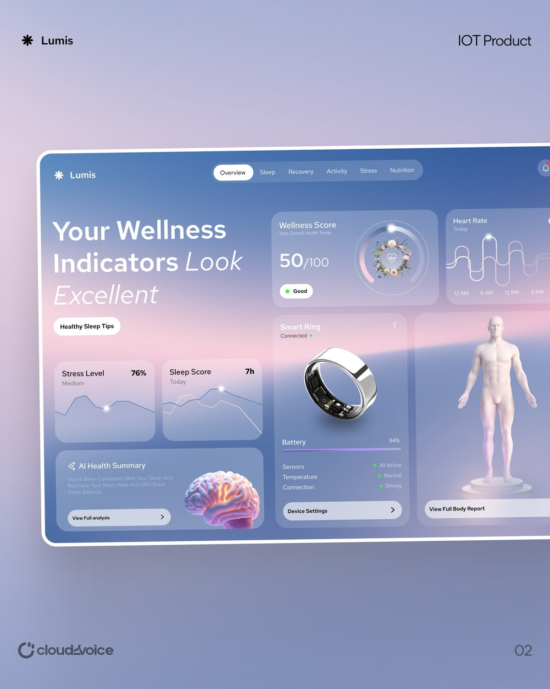

_Lull Sleep · original owner reference (`reference.jpg`; recreation `shot.jpg`, card `thumb.jpg`)._

A soft glass wellness board over a lavender sky: score and smart ring at the center, stress and sleep sparks, heart rate, and a glowing body report — with Sleep, Recovery, Activity and Settings pages.

- **Use cases:** Health & fitness · **Mode:** light · **Mood:** calm, gentle, dreamy, reassuring, soft
- **Pages:** Overview (`overview`, Dashboard) · Sleep (`sleep`, Report) · Recovery (`recovery`, Report) · Activity (`activity`, List) · Settings (`settings`, Settings)
- **Motion:** count-up, stagger, chart-draw, hover-lift, press, page-transition, icon-state, toast, ambient, skeleton
- **Signature:** Frosted glass cards over a pink–blue atmospheric wash, a floral wellness gauge, and dimensional SVG ring, brain and body scans.
- **Layout:** Top pill nav; three columns — hero copy + mini charts + AI summary; wellness gauge + smart ring; heart rate + body report.
- **Responsive:** At 1100px hero spans full width; at 720px single column, nav scrolls horizontally.
- **Fonts:** Fraunces / Figtree · **Palette:** bg `#d9e3f7`, surface `#ffffff`, text `#1a2240`, muted `#3f4a6e`, accent `#3f52d9`, chart `#4f6fe8`, pink `#c45a90`, good `#1f7a52`
- **Variants:** Lavender, Dawn, Nightfall · **Closest toolkit theme:** `blush`

**Best for**
- Sleep, wearables and wellness apps with a nightly report
- Detail screens that explain one record with a few linked views
- Consumer products where tone matters as much as numbers

**Avoid when**
- Clinical sleep studies that need full hypnogram precision
- Multi-user or admin views
- Brands that need a crisp, technical feel

**Components:** pill nav · glass cards · radial score with wreath · spark charts · heart-rate line · smart ring photo · body scan art · AI brain art · settings form · device drawer

---

### 10. Pearlwell Dental

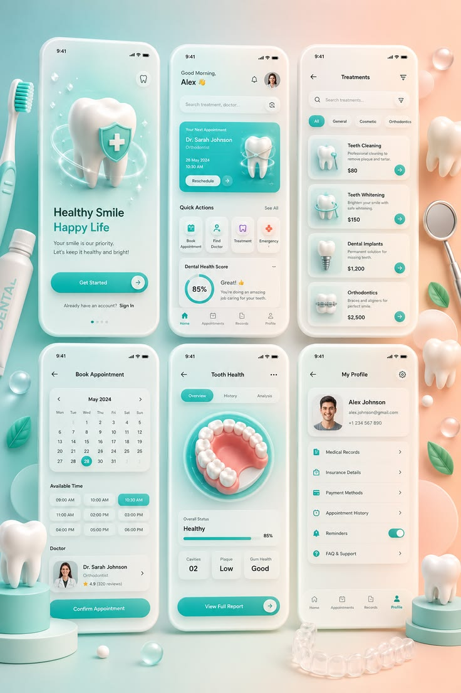

_Pearlwell Dental · original owner reference (`reference.jpg`; recreation `shot.jpg`, card `thumb.jpg`)._

A soft mint patient portal for a dental clinic: clay tooth hero with teal shield, health-score ring, booking calendar, treatments list, interactive tooth chart over an arch photo, and Appointments / Records / Payments / Profile pages.

- **Use cases:** Health & fitness · **Mode:** light · **Mood:** clean, friendly, reassuring, fresh, soft
- **Pages:** Home (`overview`, Dashboard) · Appointments (`appointments`, Calendar) · Records (`records`, List) · Payments (`payments`, List) · Profile (`profile`, Settings)
- **Motion:** count-up, stagger, hover-lift, press, page-transition, ambient, skeleton, toast, icon-state
- **Signature:** A clay tooth with teal shield on the deep-mint next-visit card, floating dental props, and an arch photo under the interactive tooth chart.
- **Layout:** 230px sticky sidebar (brand, 5 nav links, emergency note) · main: greeting header with search and avatar · 12-column grid: next visit (5) + score (3) + treatments (4, two rows) · booking card (8, two rows: month calendar left, times, dentists and confirm right) · tooth chart (4)
- **Responsive:** ≤1180px: sidebar becomes a top bar, grid 2 columns · ≤700px: icon tab bar with labels, single column, calendar above times
- **Fonts:** Nunito / Nunito · **Palette:** bg `#eaf5f2`, surface `#ffffff`, text `#173836`, muted `#4a6663`, accent `#0f7f75`, teal `#0e7f73`, peach `#fbe3d4`, warn `#b4542e`
- **Variants:** Mint, Coral, Deep sea · **Closest toolkit theme:** `coastal`

**Best for**
- Clinics, dentists, physio and other appointment-led health services
- Patient or client portals that centre on booking
- Brands that want a calm, clinical-but-friendly feel

**Avoid when**
- Clinic staff tools with schedules for many patients
- Dense reporting or finance views
- Brands that need a dark or dramatic look

**Components:** Sidebar navigation with emergency note · Clay tooth hero on next-visit card · Floating toothbrush and mirror props · Quick-action row · Score ring with explanation · Month calendar with closed days · Time-slot grid with taken slots · Dentist picker · Category chips and searchable price list · Interactive tooth chart over arch photo · Appointments / Records / Payments / Profile pages

---

### 22. Folio Club

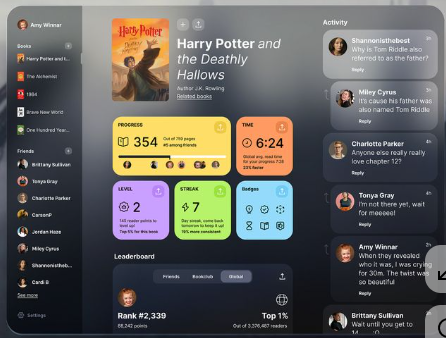

_Folio Club · original owner reference (`reference.png`; recreation `shot.jpg`, card `thumb.jpg`)._

A soft dark reading club: book shelf and friends on the left, a current-book hero with five colorful metric tiles (progress, time, level, streak, badges), a friends/club/global leaderboard, and a live activity feed.

- **Use cases:** Education, Music & media · **Mode:** dark · **Mood:** cosy, social, playful, soft, dark
- **Pages:** Overview (`overview`, Dashboard) · Library (`library`, List) · Progress (`progress`, Report) · Settings (`settings`, Settings)
- **Motion:** _none yet_
- **Signature:** Five saturated pastel metric tiles — gold progress with overlapping friend avatars on the bar, orange time, purple level, green streak, sky badges — floating on soft charcoal glass.
- **Layout:** Left rail (profile, books, friends, settings) · center stack (current book hero, metric tile grid, leaderboard) · right activity feed
- **Responsive:** ≤1180px: activity under center, rail stays · ≤960px: rail becomes horizontal strip · ≤640px: single column, tiles 1-wide, feed last
- **Fonts:** Libre Baskerville / DM Sans · **Palette:** bg `#1a1b1f`, surface `#25262c`, text `#f2f0eb`, muted `#c4c0b6`, accent `#e8c547`, tile-time `#e8894a`, tile-level `#a78bdb`, tile-streak `#7dcf5a`, tile-badges `#5ec4e8`
- **Variants:** Ink, Parchment, Night · **Closest toolkit theme:** `noir`

**Best for**
- Reading clubs, learning streaks, or media progress trackers
- Social dashboards that mix personal stats with a friend feed
- Products that want friendly color tiles without a loud neon look

**Avoid when**
- Enterprise ops or dense tabular analytics
- Brands that need a strictly corporate or light editorial look
- Screens where every tile must meet the same muted palette

**Components:** Profile avatar chip · Book list with SVG covers · Friends list with see-more · Current book hero · Color metric tiles (progress, time, level, streak, badges) · Leaderboard segmented tabs · Activity feed with reply

---

### 29. Tidebath Showroom

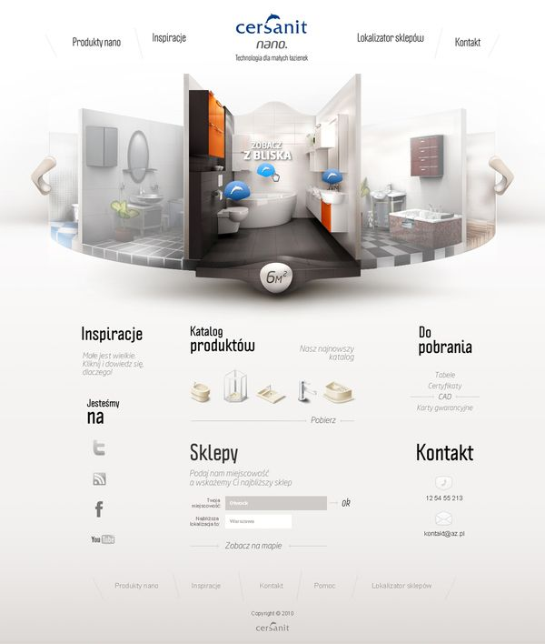

_Tidebath Showroom · original owner reference (`reference.jpg`; recreation `shot.jpg`, card `thumb.jpg`)._

A soft-light bathroom showroom: curved 3-bay photo room carousel with hotspot markers and a 6m² badge, above a four-column board for inspirations, product icons, store search and contact — plus Catalog, Orders and Settings. English copy throughout.

- **Use cases:** E-commerce & retail, Hospitality & food · **Mode:** light · **Mood:** airy, minimal, clean, sculptural, calm
- **Pages:** Overview (`overview`, Dashboard) · Catalog (`catalog`, List) · Orders (`orders`, List) · Settings (`settings`, Settings)
- **Motion:** stagger, hover-lift, press, page-transition, ambient, skeleton, toast, icon-state
- **Signature:** A soft white cylindrical stage holding three angled photoreal bathroom bays, with blue tide-wave hotspot markers and a recessed circular 6m² badge.
- **Layout:** Tidebath mark + pages nav · curved 3-bay photo carousel with prev/next, hotspots and 6m² badge · 4-column lower board (inspirations + social · product icons + store search · downloads · contact)
- **Responsive:** ≤1100px: carousel scales, board becomes 2×2 · ≤700px: nav wraps under brand, carousel full-bleed with stacked arrows, board single column
- **Fonts:** DM Serif Display / DM Sans · **Palette:** bg `#f4f5f7`, surface `#ffffff`, text `#2c333d`, muted `#4a5560`, accent `#2f6fed`, orange `#e8793a`, stage `#e8eaee`, hotspot `#3b82f6`
- **Variants:** Porcelain, Mist, Dusk · **Closest toolkit theme:** `linen`

**Best for**
- Bathroom, kitchen or furniture brands that sell through a visual showroom
- Landing pages that lead into a configurator or store locator
- Hospitality or retail spaces showcasing compact room layouts

**Avoid when**
- Dense product tables or wholesale order tooling
- Dark cinematic brands
- Dashboards that need many KPIs on first paint

**Components:** Centered brand mark with wave logo · Primary pages nav (Overview / Catalog / Orders / Settings) · Curved 3-bay photo room carousel · Prev/next carousel controls · Hotspot markers with look-closer tip · Recessed 6m² size badge · Inspirations column with social icons · Product icon strip with download link · Store city search field · Downloads link list · Contact phone and email

---

### 32. Copper Radar

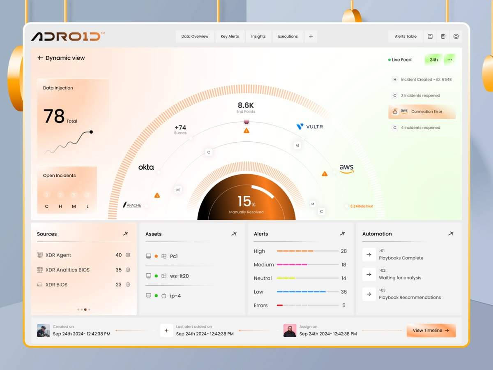

_Copper Radar · original owner reference (`reference.jpg`; recreation `shot.jpg`, card `thumb.jpg`)._

A soft-light SOC ops board: copper accents on white, concentric radar arcs with invented vendor chips, a live incident feed, dashed severity bars, automation steps and a timeline footer.

- **Use cases:** Analytics & BI · **Mode:** light · **Mood:** alert, clean, soft, operational, focused
- **Pages:** Overview (`overview`, Dashboard) · Reports (`reports`, Report) · Segments (`segments`, List) · Settings (`settings`, Settings)
- **Motion:** _none yet_
- **Signature:** Soft white SOC shell with copper accents and a large semi-circular radar of concentric arcs dotted with invented vendor chips.
- **Layout:** Top bar (brand · soft pill tabs · utilities) · Dynamic View (injection + incidents · radar · live feed) · 4-card row (Sources, Assets, Alerts, Automation) · timeline footer
- **Responsive:** ≤1180px: feed under radar · ≤960px: side cards stack, 2×2 bottom grid · ≤640px: single column, tabs scroll, timeline wraps
- **Fonts:** Sora / DM Sans · **Palette:** bg `#f5f7f9`, surface `#ffffff`, text `#1c232b`, muted `#5a6570`, accent `#c45f1a`, copper `#e07a2f`, sev-high `#d97706`, sev-med `#c0267a`
- **Variants:** Copper, Slate, Ember · **Closest toolkit theme:** `atelier`

**Best for**
- Security and observability overview screens that stay light and calm
- Ops dashboards centred on a radar or topology hero
- Incident triage boards with feed + severity + timeline

**Avoid when**
- Dark SOC walls that need neon HUD density
- Compliance tools with long tabular evidence
- Brands that cannot use warm copper accents

**Components:** Soft pill navigation tabs · Data-injection spark card · Open-incident severity chips · Concentric radar arcs with fictional vendor nodes · Live feed with filter and states · Dashed severity bars · Automation step list · Incident timeline footer with copper CTA

---

### 36. Meridian Labs

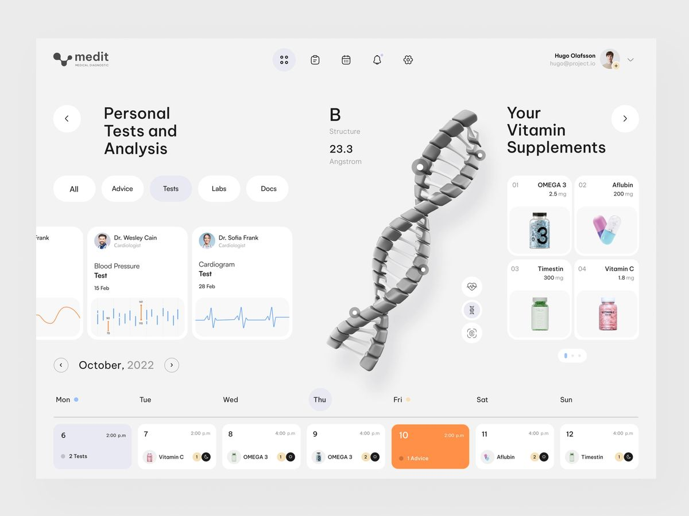

_Meridian Labs · original owner reference (`reference.jpg`; recreation `shot.jpg`, card `thumb.jpg`)._

A soft health diagnostics board: filterable doctor test cards, a code-drawn DNA helix centerpiece, a vitamin supplement grid with SVG bottles, and a week schedule strip with an orange highlight day.

- **Use cases:** Health & fitness · **Mode:** light · **Mood:** soft, clinical, calm, airy, reassuring
- **Pages:** Overview (`overview`, Dashboard) · Vitals (`vitals`, Report) · Appointments (`appointments`, Calendar) · Records (`records`, List) · Settings (`settings`, Settings)
- **Motion:** _none yet_
- **Signature:** A soft off-white diagnostics layout centered on a code-drawn DNA helix, with an orange-highlighted day on the week strip and SVG vitamin bottles instead of product photos.
- **Layout:** Top bar: brand · circular icon nav · profile · three columns: personal tests + filter pills · DNA helix · vitamin grid · full-width week schedule strip
- **Responsive:** ≤1180px: vitamins under tests, DNA stays · ≤960px: single column, DNA shortens · ≤640px: test cards and week strip scroll horizontally inside
- **Fonts:** Plus Jakarta Sans / Plus Jakarta Sans · **Palette:** bg `#f3f4f6`, surface `#ffffff`, text `#1a1d24`, muted `#6b7280`, accent `#5b7cfa`, highlight `#ff8a48`, lavender `#e8ecff`, ok `#1f7a4c`
- **Variants:** Soft blue, Citrus, Night · **Closest toolkit theme:** `blush`

**Best for**
- Consumer lab and diagnostics portals
- Supplement and wellness apps with a gentle clinical look
- Screens that need a memorable DNA or science visual without photos

**Avoid when**
- Dense EHR tables or clinician worklists
- Wearable ring UIs (see Aura Ring)
- Bold lime consumer fitness brands (see Zest Health)

**Components:** Circular icon navigation · Profile with initials avatar · Test filter pills · Doctor test card carousel with charts · SVG DNA double helix · Floating helix utility orbs · Vitamin supplement 2×2 grid · Week schedule strip with highlight day

---

## Editorial

Big serif headlines, magazine layout, image-led storytelling. Brands, content, luxury.

### 6. Ridgeline Trails

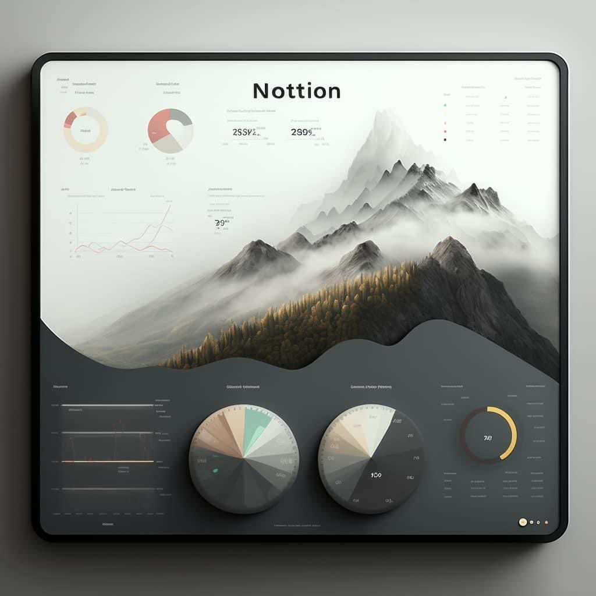

_Ridgeline Trails · original owner reference (`reference.jpg`; recreation `shot.jpg`, card `thumb.jpg`)._

A two-tone visitor report for a trail network: a pale, quiet upper half where a misty code-drawn mountain range fades in from the right, then a wave edge into a charcoal lower half of raised pie dials, thin bars and a gold ring gauge.

- **Use cases:** Travel & places, Analytics & BI · **Mode:** light · **Mood:** quiet, editorial, misty, monochrome, considered
- **Pages:** Overview (`overview`, Dashboard) · Routes (`routes`, List) · Journal (`journal`, Detail) · Settings (`settings`, Settings)
- **Motion:** _none yet_
- **Signature:** Grey mountain ridges separated by bands of mist, with an ochre forest on the front slope, dissolving into the page and cut off by a wave edge into the charcoal half.
- **Layout:** One framed board, max 1280px, thick dark bezel · upper half (pale): centred title + period toggle, left column of 2 ring stats, 2 big numbers and a line chart, right column mountain art with a conditions card · wave-shaped edge · lower half (charcoal): 4 columns (thin bar list, 2 pie dials with legends, ring gauge + small table)
- **Responsive:** ≤1080px: upper half stacks and the mountains move to a 330px strip above the wave; lower half 2×2 · ≤640px: single column, 230px mountain strip, full-width period toggle, legends as 44px rows
- **Fonts:** Sora / Inter · **Palette:** bg `#cfcfcc`, surface `#f1f1ec`, text `#1c1e20`, muted `#4d5154`, accent `#a8742a`, charcoal `#3d4144`, salmon `#b9524a`, mint `#8fd4b6`
- **Variants:** Mist, Dusk, Pine night · **Closest toolkit theme:** `linen`

**Best for**
- Parks, outdoor, travel or architecture brands that want restraint
- Weekly or seasonal reports shown on a tablet or wall display
- A small number of figures that should feel like a printed page

**Avoid when**
- Many KPIs or tables: the artwork takes the right half of the first screen
- Products that need a colourful, energetic brand
- Dense operational tools where every pixel carries data

**Components:** Centred wordmark header with period toggle · Small ring stats · Large numbers with change · Thin line chart with dashed comparison · Conditions card with status dots · Thin horizontal bar list · Raised pie dial with tick ring and selectable legend · Ring gauge with small table

---

## Bold & graphic

High contrast, saturated blocks, heavy type, brutalist or neo-brutalist edges. Creative tools, youth brands.

### 26. Zest Health

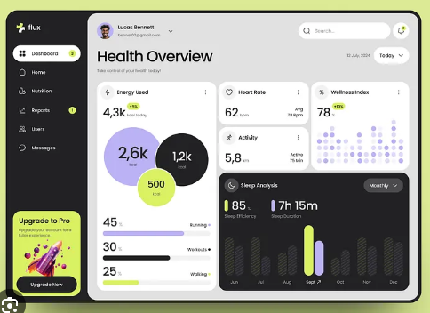

_Zest Health · original owner reference (`reference.png`; recreation `shot.jpg`, card `thumb.jpg`)._

A bold lime health overview with a charcoal sidebar, overlapping energy bubbles, heart and activity tiles, a wellness dot-matrix index, and a dark sleep-analysis panel with hatched month bars.

- **Use cases:** Health & fitness · **Mode:** light · **Mood:** bold, fresh, energetic, playful, clear
- **Pages:** Overview (`overview`, Dashboard) · Vitals (`vitals`, Report) · Appointments (`appointments`, Calendar) · Records (`records`, List) · Settings (`settings`, Settings)
- **Motion:** _none yet_
- **Signature:** Three overlapping kcal bubbles (lilac, charcoal, lime) beside a charcoal sleep panel with hatched month bars and one highlighted month.
- **Layout:** 240px dark sidebar (brand, nav with badges, upgrade card) · main: profile + search header · title row with date · bento: energy bubbles (tall) · heart · activity · wellness dot index (tall) · sleep analysis (wide dark)
- **Responsive:** ≤1180px: sidebar collapses to top nav, bento 2 columns · ≤960px: upgrade hidden · ≤640px: single column, bubbles stack
- **Fonts:** Space Grotesk / Manrope · **Palette:** bg `#dcefb0`, surface `#f4f5f7`, text `#111411`, muted `#3a453a`, accent `#b8f000`, sidebar `#121412`, lilac `#c4b5fd`, ink `#1a1c1a`
- **Variants:** Lime, Grape, Night · **Closest toolkit theme:** `atelier`

**Best for**
- Consumer wellness apps that want a high-contrast lime brand
- Daily health overviews with a few vivid metrics
- Products that mix light workspace cards with one dark chart panel

**Avoid when**
- Clinical EHR tools needing dense tables
- Brands that avoid saturated lime accents
- Wearable ring UIs that need a glass, dreamy look (see Aura Ring)

**Components:** Dark sidebar with badge counts · Upgrade callout with SVG rocket · Profile and search header · Energy bubbles with category bars · Heart rate and activity mini cards · Wellness index dot matrix · Dark sleep analysis with hatched bars

---

## Dark neon

Near-black canvas with vivid neon accents and gradients. Gaming, crypto, music, nightlife.

### 2. Pulsar Analytics

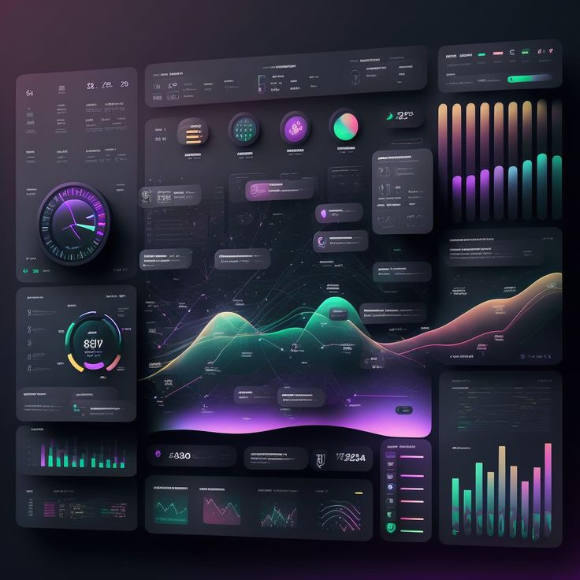

_Pulsar Analytics · original owner reference (`reference.jpg`; recreation `shot.jpg`, card `thumb.jpg`)._

A dark neon product-analytics board: glossy metric orbs switch a topographic mint/violet terrain chart with network nodes, a ticked uptime dial, gradient pillars, and Traffic / Events / Regions pages.

- **Use cases:** Analytics & BI, SaaS admin · **Mode:** dark · **Mood:** neon, technical, moody, glossy, futuristic
- **Pages:** Overview (`overview`, Dashboard) · Traffic (`traffic`, Report) · Events (`events`, List) · Regions (`regions`, Detail)
- **Motion:** count-up, stagger, chart-draw, hover-lift, press, page-transition, ambient, skeleton, toast, icon-state
- **Signature:** Layered mint and violet topographic terrain waves under a neon network of nodes, rising from a blurred purple floor glow.
- **Layout:** Top bar (brand, Overview/Traffic/Events/Regions nav, pill search, range toggle, bell, avatar) · 3 columns at 1440px: 288px left rail (uptime dial, health donut, hourly bars) · fluid centre (4 metric orbs, topographic terrain chart, 3 sparkline tiles) · 304px right rail (channel pillars, top events, regions) · 18px gaps
- **Responsive:** ≤1180px: centre column spans full width on top, rails sit side by side below, search hides · ≤960px: nav wraps under the bar, orbs 2×2 · ≤640px: single column, orbs stack, chart 200px tall
- **Fonts:** Space Grotesk / Inter · **Palette:** bg `#12111a`, surface `#1e1d28`, text `#f1eff7`, muted `#b3afc2`, accent `#c49bff`, violet `#bf00ff`, mint `#00ffcc`, peach `#ffcc33`
- **Variants:** Violet mint, Ember, Daylight · **Closest toolkit theme:** `aurora`

**Best for**
- Product, web or infrastructure analytics for a technical audience
- Wall displays and status pages that are read at a glance
- Brands that already live in dark mode

**Avoid when**
- Long tables or text-heavy admin screens: the glow tires the eye
- Conservative or regulated brands (banking, legal, healthcare)
- Print or export-first reporting

**Components:** Metric orbs (toggle buttons that switch the chart) · Topographic multi-layer terrain chart with network overlay · Segmented range toggle · Ticked dial gauge with needle · Segmented donut with legend · Gradient pillar bars (selectable) · Event list with progress bars · Sparkline tiles · Key-value list · Traffic / Events / Regions multipage views

---

### 16. Hollow Vault

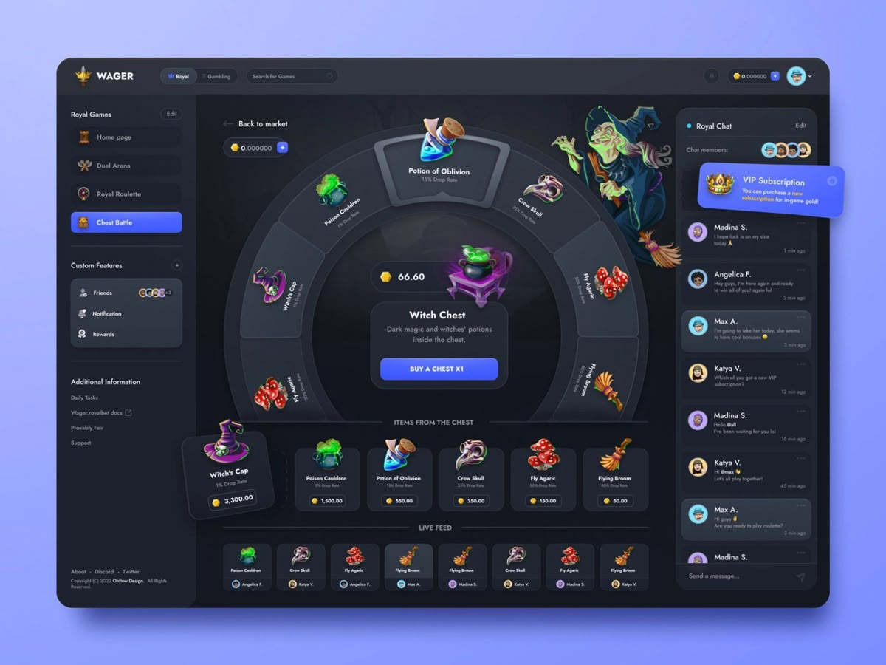

_Hollow Vault · original owner reference (`reference.jpg`; recreation `shot.jpg`, card `thumb.jpg`)._

A dark-neon rewards hub for a fantasy game. Eight painted relics ring a glowing Moonwell chest; open it with keys earned from quests. Drop rates are shown openly, a live feed and haul fill below, and guild chat runs down the right.

- **Use cases:** Music & media · **Mode:** dark · **Mood:** playful, magical, vivid, immersive, dark
- **Pages:** Quest vault (`overview`, Dashboard) · Quest board (`quests`, List) · Arena (`arena`, Board) · Guild hall (`guild`, List)
- **Motion:** count-up, stagger, hover-lift, press, page-transition, ambient, skeleton, toast, icon-state
- **Signature:** A concave neon dial of eight painted relic sprites around a brass-bound chest photo, with a flying witch prop and a floating drop-rate card.
- **Layout:** 3 columns: 240px menu (realm nav, today's quests that award keys) · main: title + key balance, relic wheel with chest core, chest contents with rarity filter, your haul · 320px guild chat with composer
- **Responsive:** ≤1180px: chat moves under the main column · ≤760px: single column, nav 2×2, wheel labels hidden, chest copy trimmed
- **Fonts:** Outfit / Outfit · **Palette:** bg `#12132a`, surface `#1b1d3a`, text `#f0f1fb`, muted `#b0b3d6`, accent `#5858e0`, rare `#5fb0ff`, epic `#c18bff`, legendary `#ffc44d`
- **Variants:** Dusk, Moss, Crimson · **Closest toolkit theme:** `midnight`

**Best for**
- Game, community and fan-club hubs
- Reward, loyalty or achievement pages
- Products that want a show-piece centre element

**Avoid when**
- Anything involving real-money loot boxes or gambling
- Business tools and serious reporting
- Light, minimal brands

**Components:** Painted relic wheel around chest photo · Flying witch atmosphere prop · Floating drop-rate detail card · Open-chest action with key cost · Quest list that awards keys · Rarity filter and drop-rate cards · Live feed of recent opens · Inventory grid with empty state · Guild chat with boost banner and composer · Quest board / Arena / Guild hall pages

---

## Tactile & neumorphic

Soft extruded surfaces, depth, physical-feeling controls. Smart home, devices, audio.

### 12. Mallow Music

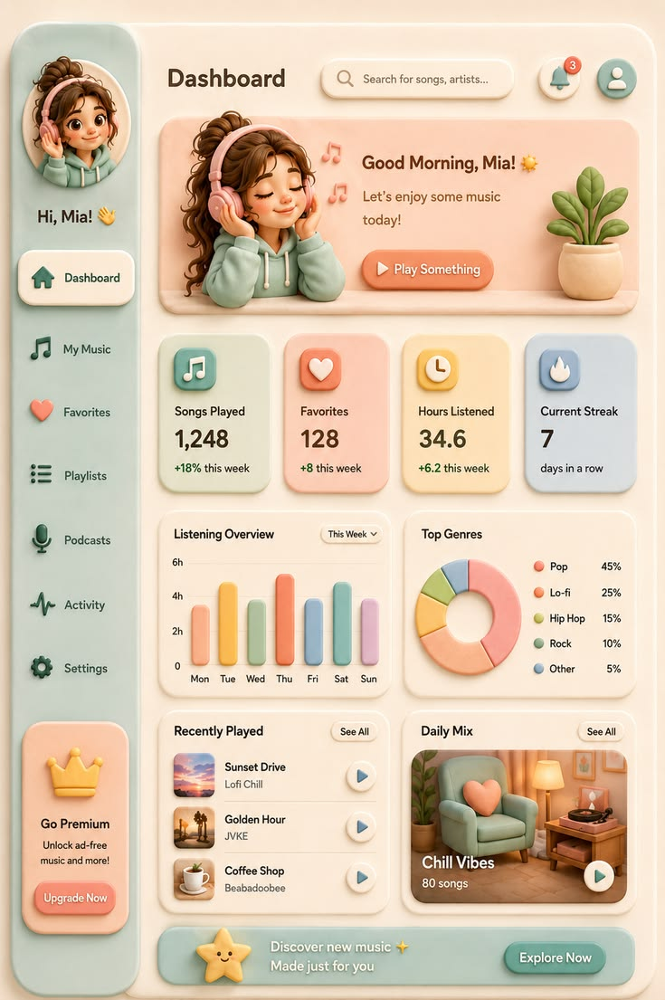

_Mallow Music · original owner reference (`reference.jpg`; recreation `shot.jpg`, card `thumb.jpg`)._

A claymorphic listening dashboard for a music app: puffy pastel tiles with soft inner highlights, a peach hero with code-drawn clay headphones and a plant, a now-playing bar you can scrub, colourful weekly listening bars, a genre donut, recently played songs and a daily mix drawn as a cosy room.

- **Use cases:** Music & media · **Mode:** light · **Mood:** cosy, playful, warm, soft, friendly
- **Pages:** Overview (`overview`, Dashboard) · Library (`library`, List) · Activity (`activity`, Report) · Settings (`settings`, Settings)
- **Motion:** _none yet_
- **Signature:** Puffy clay surfaces with an outer shadow and an inner highlight, in cream, sage, peach, butter and sky, with glossy SVG headphones on the hero shelf.
- **Layout:** 220px clay sidebar (avatar, 6 links, Plus card) · main: title + search + bell · peach hero (art 220px, greeting, plant) · now-playing bar · 4 stat tiles · listening bars (1.25fr) + top genres (1fr) · recently played + daily mix
- **Responsive:** ≤1100px: sidebar becomes a top block, stats 2×2 · ≤700px: single column, nav in 3×2 grid, hero art above copy, player wraps to two rows
- **Fonts:** Fredoka / Fredoka · **Palette:** bg `#f4ece1`, surface `#fbf6ef`, text `#3a2a20`, muted `#6b5546`, accent `#b04a2f`, sage `#cfe1d8`, peach `#f7d3c1`, butter `#f8e2b0`
- **Variants:** Cream, Berry, Cocoa · **Closest toolkit theme:** `blush`

**Best for**
- Music, podcast and audiobook apps with a personal home screen
- Consumer products aimed at a young or casual audience
- Dashboards where personality matters more than density

**Avoid when**
- Professional or financial tools
- Dense data that needs flat, sharp charts
- Brands that want a serious or premium feel

**Components:** Clay sidebar with avatar and upgrade card · Hero with greeting and play action · Now-playing bar with play/pause and scrubber · Pastel stat tiles · Multicolour bar chart with week toggle · Genre donut with selectable legend · Track list with favourite and play · Daily mix card with switchable SVG room

---

### 30. Dune Panels

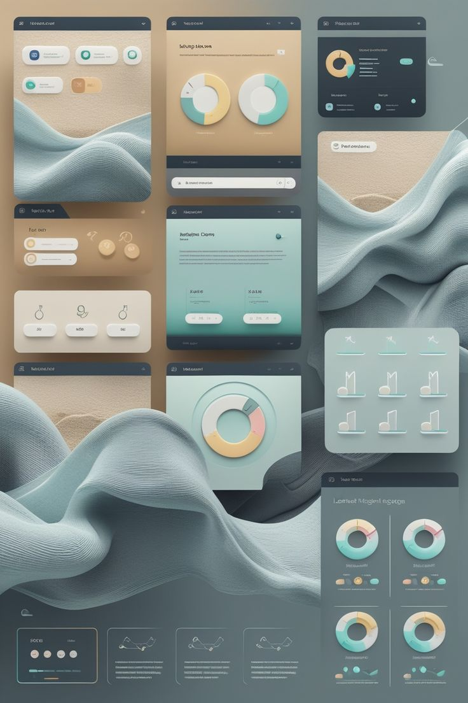

_Dune Panels · original owner reference (`reference.jpg`; recreation `shot.jpg`, card `thumb.jpg`)._

A skeuomorphic soft-UI analytics board in sand, sage and slate: fabric wave backdrop, dual donuts, a recessed neumorphic donut well, pill search, icon shelves and a 2×2 analytics grid — with Reports, Segments and Settings pages.

- **Use cases:** Analytics & BI · **Mode:** light · **Mood:** tactile, calm, organic, matte, soft
- **Pages:** Overview (`overview`, Dashboard) · Reports (`reports`, Report) · Segments (`segments`, List) · Settings (`settings`, Settings)
- **Motion:** stagger, hover-lift, press, page-transition, ambient, skeleton, toast, icon-state
- **Signature:** Sand, sage and slate panels with multi-layer neumorphic shadows, a draped blue fabric wave, and a large donut seated in a deeply recessed circular well.
- **Layout:** Fabric wave backdrop · top search on slate strip · dual donut sand panel · sage recessed donut well · 3×3 icon grid · range pills · slate 2×2 analytics donut grid with dark headers throughout
- **Responsive:** ≤1100px: two-column wrap, wave softens · ≤700px: single column, icon grid 3×3 retained, search full width, analytics 2×2 stacks
- **Fonts:** Outfit / Outfit · **Palette:** bg `#c5cfc9`, surface `#e8d9c4`, text `#2d3e4e`, muted `#3d4e5c`, accent `#4a9b8e`, sage `#9db8ae`, slate `#2d3e4e`, wave `#7a93a8`
- **Variants:** Sand, Coastal, Ember · **Closest toolkit theme:** `atelier`

**Best for**
- Analytics or ops glance boards that want a tactile, non-flat look
- Product demos showcasing neumorphic depth and soft materials
- Light-mode dashboards with a natural sand-and-sage palette

**Avoid when**
- Dense tabular reporting or spreadsheet-like tools
- Brands that need sharp glass or high-chroma charts
- Dark-only or neon cyber aesthetics

**Components:** Fabric wave photo backdrop · Dark slate panel headers · Dual donuts · Recessed neumorphic well · Pill search · 3×3 icon shelves · Range pills · 2×2 analytics grid · Reports/Segments/Settings pages

---

### 31. Pebble Studio

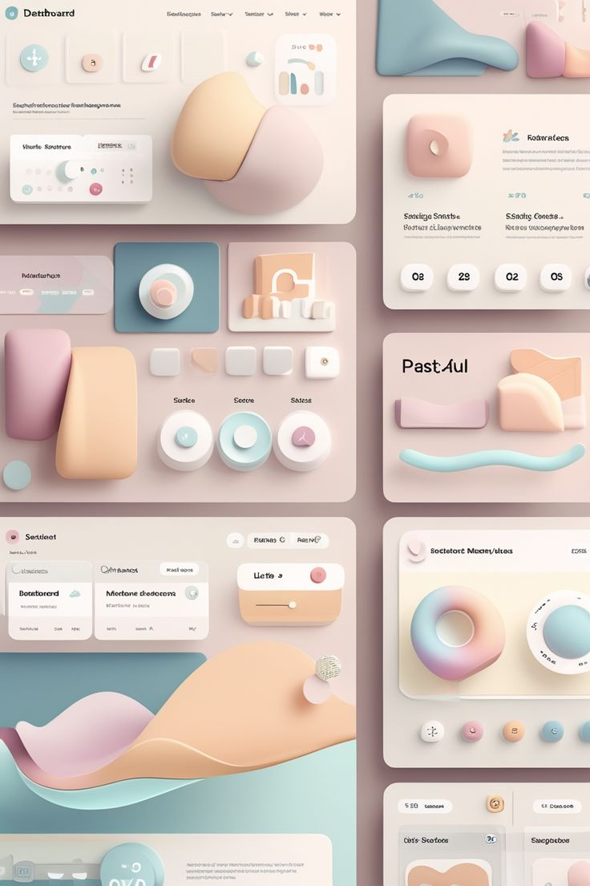

_Pebble Studio · original owner reference (`reference.jpg`; recreation `shot.jpg`, card `thumb.jpg`)._

A cream-and-pink soft-UI studio admin: extruded nav pills, clay pebble photo props, circular knobs, layered wave dunes, and a clay torus beside a tick-mark dial — plus Workspace, People and Settings.

- **Use cases:** SaaS admin · **Mode:** light · **Mood:** tactile, playful, soft, warm, calm
- **Pages:** Overview (`overview`, Dashboard) · Workspace (`workspace`, List) · People (`people`, List) · Settings (`settings`, Settings)
- **Motion:** count-up, stagger, hover-lift, press, page-transition, ambient, skeleton, toast, icon-state
- **Signature:** Clay pebble and torus photo props on neumorphic cream surfaces, with extruded soft pills and a clarity dial.
- **Layout:** Top extruded pill nav · blob stage + torus/dial analytics · wave dunes + knobs + lite slider · pastel activity feed + KPI pill strip
- **Responsive:** ≤1180px: two-column bento · ≤960px: nav wraps, torus under blobs · ≤640px: single column, knobs in a row, feed last
- **Fonts:** Nunito / Nunito · **Palette:** bg `#efe6df`, surface `#f7f1eb`, text `#3a2c28`, muted `#4a3a34`, accent `#a84f42`, peach `#f0b49a`, candy `#e9a6b5`, mint `#9fcfbe`
- **Variants:** Cream, Coral, Moss · **Closest toolkit theme:** `blush`

**Best for**
- Creative or design SaaS homes that want a kit-like soft-UI feel
- Admin overviews where tactile dials and pills carry the brand
- Light-mode products that lean skeuomorphic without heavy chrome

**Avoid when**
- Dense tables or finance-grade precision charts
- Dark, technical security brands
- Brands that need flat, sharp corners

**Components:** Extruded soft nav pills and pages nav · Clay pebble photo stage with mood filters · Floating circular knobs with ± controls · Wave-dune SVG analytics card · Clay torus photo + tick dial card · Neumorphic KPI pills

---

### 33. Orbit Clay

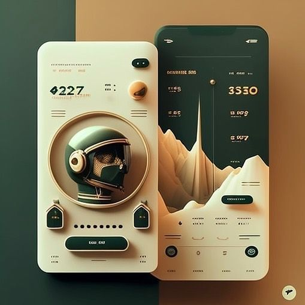

_Orbit Clay · original owner reference (`reference.jpg`; recreation `shot.jpg`, card `thumb.jpg`)._

Cream, forest and gold claymorphism for an immersive media console: twin phone panels with a clay astronaut helmet photo in a gold ring, a START pill, and a cream dune landscape with a calibration rail — plus Library, Activity and Settings pages.

- **Use cases:** Music & media · **Mode:** light · **Mood:** tactile, playful, premium, earthy, curious
- **Pages:** Overview (`overview`, Dashboard) · Library (`library`, List) · Activity (`activity`, Report) · Settings (`settings`, Settings)
- **Motion:** count-up, stagger, hover-lift, press, page-transition, ambient, skeleton, toast, icon-state
- **Signature:** Twin clay phones: gold-ring helmet photo on cream, forest-green START, and a soft clay dune landscape with a vertical altitude rail.
- **Layout:** Split stage · twin phone panels: mission phone (score, gold-ring helmet, pager, START) · calibration phone (KPI stack, clay terrain, gold sphere rail, foot icons)
- **Responsive:** ≤1100px: panels stack centred · ≤700px: single phone width, stage padding shrinks, foot icons wrap
- **Fonts:** Outfit / Outfit · **Palette:** bg `#f3ebe0`, surface `#f7f0e6`, text `#1f3a2e`, muted `#4a6356`, accent `#c9a24a`, forest `#1f3a2e`, gold `#c9a24a`, cream `#f7f0e6`
- **Variants:** Orbit, Moss, Dusk · **Closest toolkit theme:** `linen`

**Best for**
- Media, game or experiential apps that want a toy-like clay interface
- Phone-first concepts shown as twin panels on desktop
- Brand explorations that need soft depth without glass

**Avoid when**
- Dense analytics or financial tools
- Clinical or high-contrast accessibility-first UIs
- Flat material or neon dark-neon brands

**Components:** Twin clay phone shells · Gold-ring astronaut hero SVG · Mission pager dots and house markers · Pressable START pill · Vertical gold-sphere calibration slider · Clay mountain terrain SVG · Stacked gold KPI numbers · Foot icon strip · Clay helmet photo in gold ring · Clay dune landscape photo · Library / Activity / Settings multipage

---

### 38. Ember Rooms

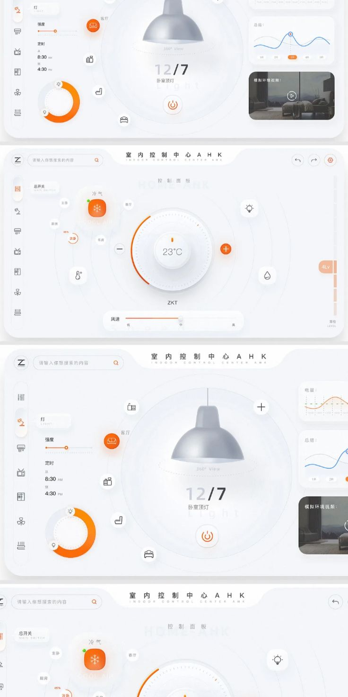

_Ember Rooms · original owner reference (`reference.jpg`; recreation `shot.jpg`, card `thumb.jpg`)._

A soft neumorphic indoor lighting console: orange accent, left icon rail, pill search, pendant lamp photo on orbit rings, intensity slider, schedule, climate dial on Devices, line charts and a photo room preview.

- **Use cases:** Smart home & IoT · **Mode:** light · **Mood:** tactile, soft, warm, calm, orange
- **Pages:** Overview (`overview`, Dashboard) · Rooms (`rooms`, List) · Devices (`devices`, List) · Energy (`energy`, Report) · Settings (`settings`, Settings)
- **Motion:** count-up, stagger, hover-lift, press, page-transition, ambient, skeleton, toast, icon-state
- **Signature:** A soft extruded well with a matte pendant lamp photo hanging inside concentric orbit rings, orange room dots and a bright orange power control.
- **Layout:** 64px icon rail · top (search, brand, undo/redo/settings) · soft main well: left stack (intensity, schedule, arc dial) · centre pendant stage with orbit room dots · right stack (line chart, spark, video-sim)
- **Responsive:** ≤1180px: right stack drops under centre · ≤960px: rail becomes top strip · ≤640px: single column, room dots scroll, charts full width
- **Fonts:** Outfit / Outfit · **Palette:** bg `#f2f1ef`, surface `#f7f6f4`, text `#2a2622`, muted `#4a443c`, accent `#c45500`, blue `#4a8fd8`, lamp `#9a9a9e`, well `#ecebe8`
- **Variants:** Ember, Mist, Dusk · **Closest toolkit theme:** `linen`

**Best for**
- Lighting-first smart-home or hospitality room tablets
- Products that want soft extruded controls without heavy glass
- Single-room focus with a clear power and dimmer story

**Avoid when**
- Climate-first HVAC dashboards (use a dial twin instead)
- Dense multi-device fleet admin
- Dark cinematic brands that need scenic photography

**Components:** Slim icon rail wired to multipage routes · Pill search field · Undo / redo / settings orb buttons · Horizontal intensity slider · Schedule start–end row · Circular brightness dial · Pendant lamp photo hero with glow · Orbiting room picker dots · Power toggle and lights fraction · Multi-line energy chart · Secondary spark line · Photo room preview with play · Climate dial on Devices page

---

