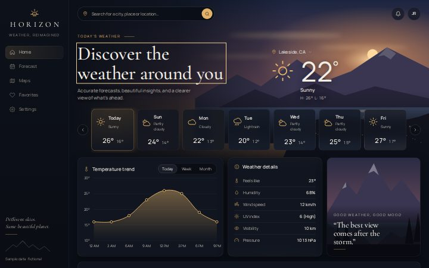
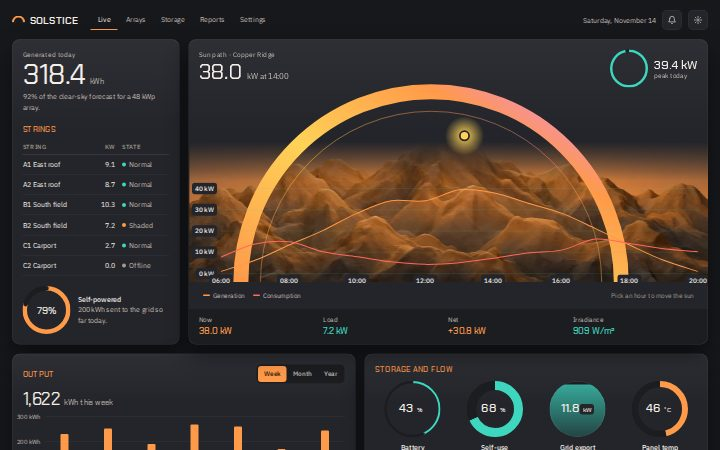
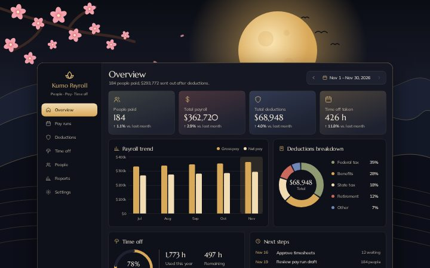
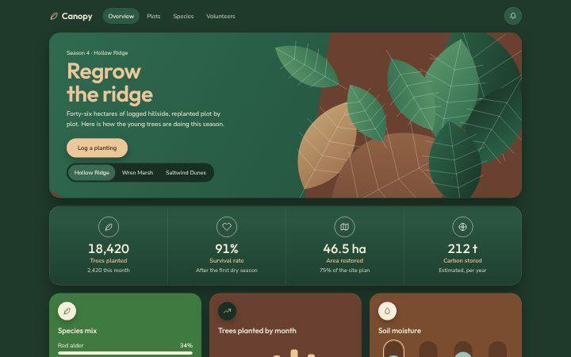
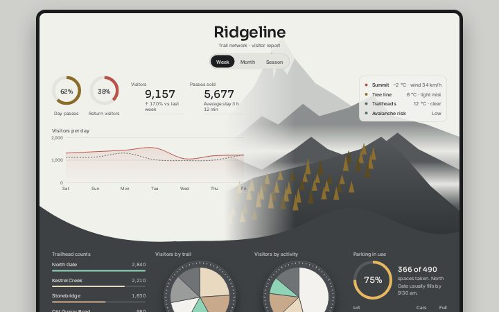
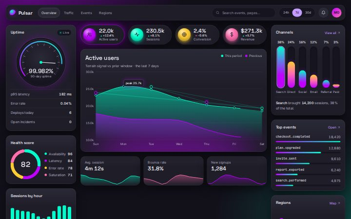

<!-- GENERATED by scripts/build.mjs from catalog/dashboards.json. Do not edit by hand. -->

# Dashboard gallery catalog

6 dashboards in 10 style families. Source: [catalog/dashboards.json](../../catalog/dashboards.json). How to choose and how to add: [README](README.md).

| # | Dashboard | Style | Use cases | Mode | Variants | Folder |
|---|---|---|---|---|---|---|
| 1 | [Horizon Weather](#horizon-weather) | Cinematic & atmospheric | Weather & climate, Travel & places | dark | Dusk, Dawn, Night | [site/dashboards/horizon-weather/](../../site/dashboards/horizon-weather/) |
| 2 | [Pulsar Analytics](#pulsar-analytics) | Dark neon | Analytics & BI, SaaS admin | dark | Violet mint, Ember, Daylight | [site/dashboards/pulsar-analytics/](../../site/dashboards/pulsar-analytics/) |
| 3 | [Solstice Energy](#solstice-energy) | Cinematic & atmospheric | Analytics & BI, Smart home & IoT | dark | Ember, Glacier, Paper | [site/dashboards/solstice-energy/](../../site/dashboards/solstice-energy/) |
| 4 | [Kumo Payroll](#kumo-payroll) | Cinematic & atmospheric | HR & people, Finance & banking | dark | Moonlit gold, Jade, Sakura | [site/dashboards/kumo-payroll/](../../site/dashboards/kumo-payroll/) |
| 5 | [Canopy Reforest](#canopy-reforest) | Soft & friendly | Projects & tasks, Analytics & BI | dark | Forest, Autumn, Birch | [site/dashboards/canopy-reforest/](../../site/dashboards/canopy-reforest/) |
| 6 | [Ridgeline Trails](#ridgeline-trails) | Editorial | Travel & places, Analytics & BI | light | Mist, Dusk, Pine night | [site/dashboards/ridgeline-trails/](../../site/dashboards/ridgeline-trails/) |

## Cinematic & atmospheric

Dark, moody, scenic backdrops (painted or photographic) with glass panels and one warm accent. For consumer products that should feel like an experience.

### 1. Horizon Weather

A cinematic weather home: painted sunset landscape behind glass panels, an editorial serif headline, a 7-day forecast strip with a glowing selected day, a smooth gold temperature curve and a mood card.

- **Use cases:** Weather & climate, Travel & places · **Mode:** dark · **Mood:** cinematic, calm, premium, warm, editorial
- **Signature:** Code-drawn sunset landscape (SVG, themed by CSS variables) fading into the dark UI, with a gold glow ring on the selected day.
- **Layout:** Fixed left sidebar (brand, 5-item nav, quote) · top bar (pill search, bell, avatar) · hero (headline left, current conditions right) over a painted scene · 7-day strip · 3 columns: area chart, details list, story card · popular-locations row
- **Responsive:** ≤1180px: chart spans full width above details + story · ≤960px: sidebar becomes a top bar, hero stacks · ≤640px: single column, icon-only nav, day strip scrolls horizontally
- **Fonts:** Cormorant Garamond / Manrope · **Palette:** bg `#0b0f17`, surface `#121722`, text `#f4efe6`, muted `#b7b2a8`, accent `#e2b26a`, sky `#6b4a5a`, glow `#e59a5c`
- **Variants:** Dusk, Dawn, Night · **Closest toolkit theme:** `ember`

**Best for**
- Consumer apps where the feeling matters as much as the numbers
- Travel, outdoor, hospitality or lifestyle dashboards
- Landing-page heroes for a data product

**Avoid when**
- Dense business data (tables, many KPIs): the scenery competes with numbers
- Light-mode-only brands
- Low-end devices that struggle with backdrop blur

**Components:** Pill search with accent button · Hero metric (big thin temperature) · Selectable forecast cards (listbox, arrow keys) · Area chart with range toggle and hover/focus values · Key-value details list with icons · Image story card with serif quote · Circular location thumbnails · Ghost button

---

### 3. Solstice Energy

A cinematic solar-monitoring board: a thick gradient sun-path arc rises over a code-drawn mountain range, with generation and load curves on a teal grid, a readout strip, storage dials and round site thumbnails.

- **Use cases:** Analytics & BI, Smart home & IoT · **Mode:** dark · **Mood:** cinematic, warm, technical, atmospheric, instrument-like
- **Signature:** A thick yellow-to-orange-to-pink arc tracing the sun's path, cut by faceted orange mountains drawn in SVG; the sun dot moves to the hour you pick.
- **Layout:** Slim top bar (brand, 4-item nav, date, 2 icon buttons) · 12-column grid at 1440px, 18px gaps: 3-column rail (today's total, strings table, self-powered ring) + 9-column hero (sun arc scene, hourly chart, 6-item readout strip) · then 2×2 half-width panels (output bars with range toggle, 4 storage dials, hourly load bars, 4 site thumbnails)
- **Responsive:** ≤1180px: hero full width on top, rail becomes a two-column panel below · ≤760px: single column, hero chart 130px, readout strip 3×2, dials and sites 2×2
- **Fonts:** Chakra Petch / IBM Plex Sans · **Palette:** bg `#17181c`, surface `#24252a`, text `#f3eee7`, muted `#b5afa6`, accent `#ff9a4a`, teal `#3fd6c0`, coral `#ff6a5c`, pink `#f08ad0`
- **Variants:** Ember, Glacier, Paper · **Closest toolkit theme:** `ember`

**Best for**
- Energy, solar, climate or outdoor-equipment monitoring
- A single hero metric that follows the time of day
- Control-room or kiosk screens with a strong visual identity

**Avoid when**
- Many records to scan or edit: the hero scene takes most of the first screen
- Brands that need a neutral, corporate look
- Data with no natural day cycle or location

**Components:** Sun-path arc scene with movable sun · Two-series hourly line chart (pick an hour) · Readout strip (6 values) · Hero number with unit · Status table with state dots · Progress rings and liquid-fill dial · Bar chart with range toggle · Round landscape site picker

---

### 4. Kumo Payroll

A moonlit payroll overview: a code-drawn ink landscape with a gold moon, layered hills and a blossom branch sits behind one dark, gold-edged panel holding KPI tiles, a gross/net bar chart, a deductions donut and time-off ring.

- **Use cases:** HR & people, Finance & banking · **Mode:** dark · **Mood:** cinematic, serene, luxurious, eastern, warm
- **Signature:** A glowing gold moon, ink-line hills and a cherry-blossom branch drawn in SVG behind a dark panel with a thin gold edge.
- **Layout:** Fixed illustrated scene behind the page · one centred panel, max 1240px, offset 210px from the top so the moon shows · inside: 216px sidebar (brand, 7-item nav, wave pattern) + 12-column main grid, 16px gaps: header with pay-period stepper · 4 KPI tiles · trend chart (7 cols) + deductions (5 cols) · time off (6) + next steps (6)
- **Responsive:** ≤1080px: sidebar becomes a scrolling top nav, KPIs 2×2, cards stack · ≤640px: panel offset 130px, icon-only nav, period stepper full width, donut and legend stack
- **Fonts:** Marcellus / Mulish · **Palette:** bg `#0b0d14`, surface `#151823`, text `#f5ecdc`, muted `#bdb3a2`, accent `#e2bd7a`, gold `#d9a95a`, petal `#f3a2ae`, indigo `#6f86b8`
- **Variants:** Moonlit gold, Jade, Sakura · **Closest toolkit theme:** `noir`

**Best for**
- HR, payroll or people tools that want a calm, premium feeling
- Hospitality, wellness or boutique brands with an illustrated identity
- Monthly summaries with a handful of headline figures

**Avoid when**
- Dense employee tables or bulk editing: the single framed panel limits width
- Brands that need a neutral enterprise look
- Screens that must fill a wide monitor edge to edge

**Components:** Sidebar nav with gold active pill · Pay-period stepper · Tinted KPI tiles with change vs. last month · Grouped bar chart (pick a month) · Donut with selectable legend · Progress ring with stat grid · Dated task list · Serif pull quote

---

## Glass & glow

Frosted translucent panels over gradients or blurred color fields, soft glows. Modern, techy, premium.

_No dashboards yet._

## Minimal & airy

Lots of white space, hairlines, one accent, quiet type. Calm tools people use all day.

_No dashboards yet._

## Bento grid

Tiles of different sizes in a tight grid, each tile one idea. Great for overviews and product showcases.

_No dashboards yet._

## Data-dense pro

Compact tables, many small charts, tight spacing, monospace numbers. Trading, ops, analytics power users.

_No dashboards yet._

## Soft & friendly

Rounded shapes, pastel fills, playful illustration-free warmth. Health, education, personal apps.

### 5. Canopy Reforest

An organic reforestation tracker in forest green, bark brown and tan: a leafy code-drawn hero with a big rounded headline, a deep green band of four site figures and six soft, colour-blocked tiles for species, planting, soil, tasks and crews.

- **Use cases:** Projects & tasks, Analytics & BI · **Mode:** dark · **Mood:** organic, calm, earthy, friendly, soft
- **Signature:** Overlapping green and tan leaves with fine veins, drawn from one SVG path, spilling over a bark-brown wedge in the hero.
- **Layout:** Centred 1240px column, 20px gaps · top bar (brand, 4-item nav, bell) · 380px hero (copy left, leaf artwork right, CTA + site switcher) · 4-column metrics band · 3×2 grid of colour-blocked tiles (species bars, monthly planting bars, soil gauges, landscape tile, checklist, crews)
- **Responsive:** ≤980px: tiles 2 columns, metrics band 2×2 · ≤640px: single column, leaves move above the headline, site switcher and CTA full width
- **Fonts:** Outfit / Nunito Sans · **Palette:** bg `#1f3a2b`, surface `#2c5a44`, text `#f6efdc`, muted `#d3d9c4`, accent `#ecc79a`, leaf `#3f7a40`, bark `#6a4130`, tan `#dcb98c`
- **Variants:** Forest, Autumn, Birch · **Closest toolkit theme:** `grove`

**Best for**
- Sustainability, conservation, farming or garden projects
- Public-facing progress pages that mix a landing-page hero with live figures
- Community or volunteer tools that should feel welcoming

**Avoid when**
- Dense operational data or long tables
- Finance, security or other serious, high-precision domains
- Products that need many chart colours: the palette is deliberately narrow

**Components:** Hero with headline, lede and pill CTA · Site switcher (segmented) · Metrics band with ringed icons · Horizontal share bars · Bar chart with hover/focus values · Selectable capsule gauges · Illustrated landscape tile with caption · Checklist · Crew list with initials

---

## Editorial

Big serif headlines, magazine layout, image-led storytelling. Brands, content, luxury.

### 6. Ridgeline Trails

A two-tone visitor report for a trail network: a pale, quiet upper half where a misty code-drawn mountain range fades in from the right, then a wave edge into a charcoal lower half of raised pie dials, thin bars and a gold ring gauge.

- **Use cases:** Travel & places, Analytics & BI · **Mode:** light · **Mood:** quiet, editorial, misty, monochrome, considered
- **Signature:** Grey mountain ridges separated by bands of mist, with an ochre forest on the front slope, dissolving into the page and cut off by a wave edge into the charcoal half.
- **Layout:** One framed board, max 1280px, thick dark bezel · upper half (pale): centred title + period toggle, left column of 2 ring stats, 2 big numbers and a line chart, right column mountain art with a conditions card · wave-shaped edge · lower half (charcoal): 4 columns (thin bar list, 2 pie dials with legends, ring gauge + small table)
- **Responsive:** ≤1080px: upper half stacks and the mountains move to a 330px strip above the wave; lower half 2×2 · ≤640px: single column, 230px mountain strip, full-width period toggle, legends as 44px rows
- **Fonts:** Sora / Inter · **Palette:** bg `#cfcfcc`, surface `#f1f1ec`, text `#1c1e20`, muted `#4d5154`, accent `#a8742a`, charcoal `#3d4144`, salmon `#b9524a`, mint `#8fd4b6`
- **Variants:** Mist, Dusk, Pine night · **Closest toolkit theme:** `linen`

**Best for**
- Parks, outdoor, travel or architecture brands that want restraint
- Weekly or seasonal reports shown on a tablet or wall display
- A small number of figures that should feel like a printed page

**Avoid when**
- Many KPIs or tables: the artwork takes the right half of the first screen
- Products that need a colourful, energetic brand
- Dense operational tools where every pixel carries data

**Components:** Centred wordmark header with period toggle · Small ring stats · Large numbers with change · Thin line chart with dashed comparison · Conditions card with status dots · Thin horizontal bar list · Raised pie dial with tick ring and selectable legend · Ring gauge with small table

---

## Bold & graphic

High contrast, saturated blocks, heavy type, brutalist or neo-brutalist edges. Creative tools, youth brands.

_No dashboards yet._

## Dark neon

Near-black canvas with vivid neon accents and gradients. Gaming, crypto, music, nightlife.

### 2. Pulsar Analytics

A dark neon product-analytics overview: glossy metric orbs that switch the main chart, layered violet and mint wave areas over a purple floor glow, a ticked uptime dial and gradient pillar bars.

- **Use cases:** Analytics & BI, SaaS admin · **Mode:** dark · **Mood:** neon, technical, moody, glossy, futuristic
- **Signature:** Violet and mint wave areas rising out of a blurred purple floor glow, with glossy sphere-like metric buttons above.
- **Layout:** Top bar (brand, 4-item nav, pill search, range toggle, bell, avatar) · 3 columns at 1440px: 288px left rail (uptime dial, health donut, hourly bars) · fluid centre (4 metric orbs, wave chart, 3 sparkline tiles) · 304px right rail (channel pillars, top events, regions) · 18px gaps
- **Responsive:** ≤1180px: centre column spans full width on top, rails sit side by side below, search hides · ≤960px: nav wraps under the bar, orbs 2×2 · ≤640px: single column, orbs stack, chart 200px tall
- **Fonts:** Space Grotesk / Inter · **Palette:** bg `#17161d`, surface `#23222b`, text `#f1eff7`, muted `#b3afc2`, accent `#b88cff`, violet `#a06bff`, mint `#3fe0a5`, peach `#ff9d5c`
- **Variants:** Violet mint, Ember, Daylight · **Closest toolkit theme:** `aurora`

**Best for**
- Product, web or infrastructure analytics for a technical audience
- Wall displays and status pages that are read at a glance
- Brands that already live in dark mode

**Avoid when**
- Long tables or text-heavy admin screens: the glow tires the eye
- Conservative or regulated brands (banking, legal, healthcare)
- Print or export-first reporting

**Components:** Metric orbs (toggle buttons that switch the chart) · Two-series wave area chart with hover/focus values · Segmented range toggle · Ticked dial gauge with needle · Segmented donut with legend · Gradient pillar bars (selectable) · Event list with progress bars · Sparkline tiles · Key-value list

---

## Tactile & neumorphic

Soft extruded surfaces, depth, physical-feeling controls. Smart home, devices, audio.

_No dashboards yet._

