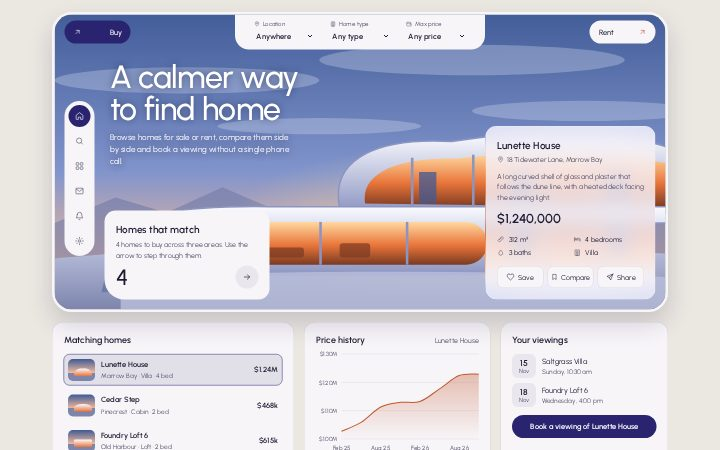
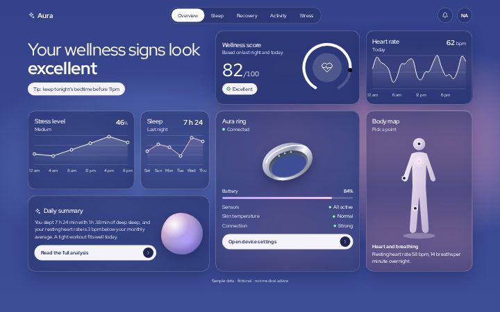
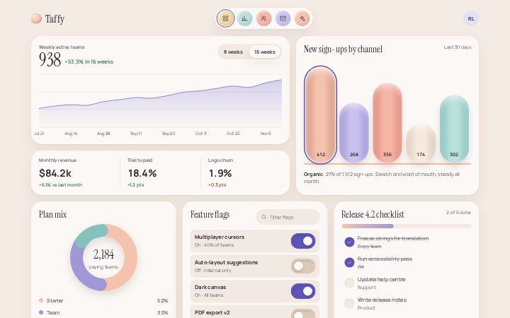
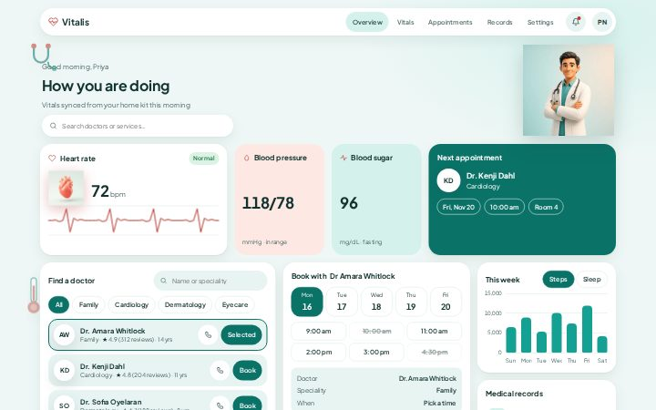
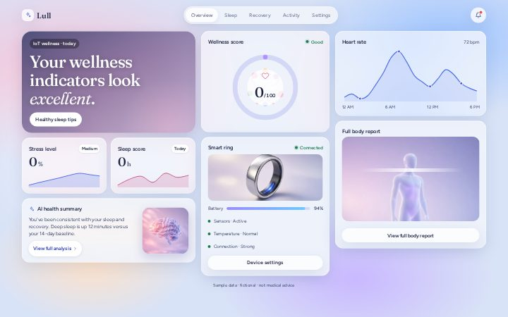
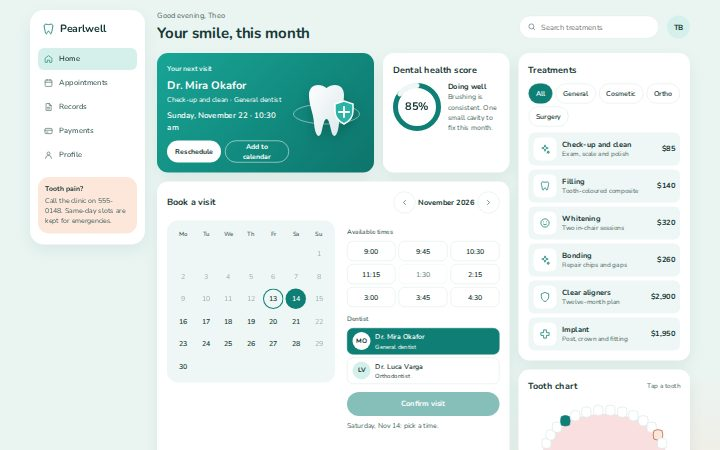
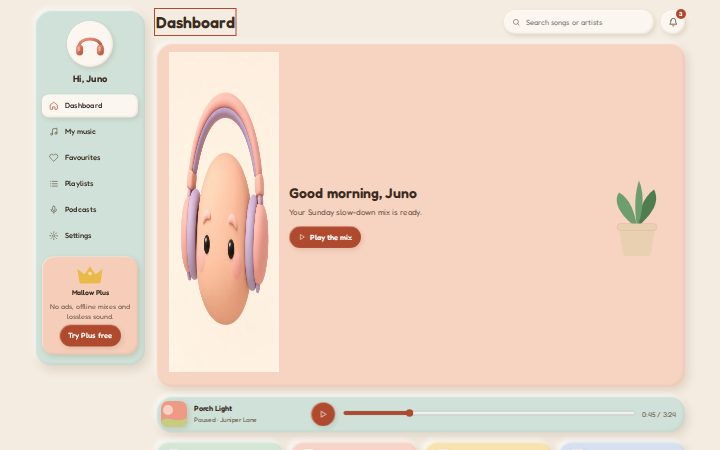

<!-- GENERATED by scripts/build.mjs from catalog/dashboards.json. Do not edit by hand. -->

# Dashboard gallery catalog

13 dashboards in 10 style families. Source: [catalog/dashboards.json](../../catalog/dashboards.json). How to choose and how to add: [README](README.md).

| # | Dashboard | Style | Use cases | Mode | Variants | Folder |
|---|---|---|---|---|---|---|
| 1 | [Horizon Weather](#horizon-weather) | Cinematic & atmospheric | Weather & climate, Travel & places | dark | Dusk, Dawn, Night | [site/dashboards/horizon-weather/](../../site/dashboards/horizon-weather/) |
| 2 | [Pulsar Analytics](#pulsar-analytics) | Dark neon | Analytics & BI, SaaS admin | dark | Violet mint, Ember, Daylight | [site/dashboards/pulsar-analytics/](../../site/dashboards/pulsar-analytics/) |
| 3 | [Solstice Energy](#solstice-energy) | Cinematic & atmospheric | Analytics & BI, Smart home & IoT | dark | Ember, Glacier, Paper | [site/dashboards/solstice-energy/](../../site/dashboards/solstice-energy/) |
| 4 | [Kumo Payroll](#kumo-payroll) | Cinematic & atmospheric | HR & people, Finance & banking | dark | Moonlit gold, Jade, Sakura | [site/dashboards/kumo-payroll/](../../site/dashboards/kumo-payroll/) |
| 5 | [Canopy Reforest](#canopy-reforest) | Soft & friendly | Projects & tasks, Analytics & BI | dark | Forest, Autumn, Birch | [site/dashboards/canopy-reforest/](../../site/dashboards/canopy-reforest/) |
| 6 | [Ridgeline Trails](#ridgeline-trails) | Editorial | Travel & places, Analytics & BI | light | Mist, Dusk, Pine night | [site/dashboards/ridgeline-trails/](../../site/dashboards/ridgeline-trails/) |
| 7 | [Haven Listings](#haven-listings) | Glass & glow | Real estate | light | Dusk, Sunrise, Midnight | [site/dashboards/haven-listings/](../../site/dashboards/haven-listings/) |
| 8 | [Aura Ring](#aura-ring) | Glass & glow | Health & fitness | dark | Haze, Lagoon, Pearl | [site/dashboards/aura-ring/](../../site/dashboards/aura-ring/) |
| 9 | [Lull Sleep](#lull-sleep) | Soft & friendly | Health & fitness | light | Lavender, Dawn, Nightfall | [site/dashboards/lull-sleep/](../../site/dashboards/lull-sleep/) |
| 10 | [Pearlwell Dental](#smile-dental) | Soft & friendly | Health & fitness | light | Mint, Coral, Deep sea | [site/dashboards/smile-dental/](../../site/dashboards/smile-dental/) |
| 11 | [Vitalis Care](#vitalis-care) | Bento grid | Health & fitness | light | Teal, Sage, Night | [site/dashboards/vitalis-care/](../../site/dashboards/vitalis-care/) |
| 12 | [Mallow Music](#mallow-music) | Tactile & neumorphic | Music & media | light | Cream, Berry, Cocoa | [site/dashboards/mallow-music/](../../site/dashboards/mallow-music/) |
| 13 | [Taffy Analytics](#taffy-analytics) | Minimal & airy | SaaS admin, Analytics & BI | light | Taffy, Mint, Dusk | [site/dashboards/taffy-analytics/](../../site/dashboards/taffy-analytics/) |

## Cinematic & atmospheric

Dark, moody, scenic backdrops (painted or photographic) with glass panels and one warm accent. For consumer products that should feel like an experience.

### 1. Horizon Weather

A cinematic weather home: painted sunset landscape behind glass panels, an editorial serif headline, a 7-day forecast strip with a glowing selected day, a smooth gold temperature curve and a mood card.

- **Use cases:** Weather & climate, Travel & places · **Mode:** dark · **Mood:** cinematic, calm, premium, warm, editorial
- **Signature:** Code-drawn sunset landscape (SVG, themed by CSS variables) fading into the dark UI, with a gold glow ring on the selected day.
- **Layout:** Fixed left sidebar (brand, 5-item nav, quote) · top bar (pill search, bell, avatar) · hero (headline left, current conditions right) over a painted scene · 7-day strip · 3 columns: area chart, details list, story card · popular-locations row
- **Responsive:** ≤1180px: chart spans full width above details + story · ≤960px: sidebar becomes a top bar, hero stacks · ≤640px: single column, icon-only nav, day strip scrolls horizontally
- **Fonts:** Cormorant Garamond / Manrope · **Palette:** bg `#0b0f17`, surface `#121722`, text `#f4efe6`, muted `#b7b2a8`, accent `#e2b26a`, sky `#6b4a5a`, glow `#e59a5c`
- **Variants:** Dusk, Dawn, Night · **Closest toolkit theme:** `ember`

**Best for**
- Consumer apps where the feeling matters as much as the numbers
- Travel, outdoor, hospitality or lifestyle dashboards
- Landing-page heroes for a data product

**Avoid when**
- Dense business data (tables, many KPIs): the scenery competes with numbers
- Light-mode-only brands
- Low-end devices that struggle with backdrop blur

**Components:** Pill search with accent button · Hero metric (big thin temperature) · Selectable forecast cards (listbox, arrow keys) · Area chart with range toggle and hover/focus values · Key-value details list with icons · Image story card with serif quote · Circular location thumbnails · Ghost button

---

### 3. Solstice Energy

A cinematic solar-monitoring board: a thick gradient sun-path arc rises over a code-drawn mountain range, with generation and load curves on a teal grid, a readout strip, storage dials and round site thumbnails.

- **Use cases:** Analytics & BI, Smart home & IoT · **Mode:** dark · **Mood:** cinematic, warm, technical, atmospheric, instrument-like
- **Signature:** A thick yellow-to-orange-to-pink arc tracing the sun's path, cut by faceted orange mountains drawn in SVG; the sun dot moves to the hour you pick.
- **Layout:** Slim top bar (brand, 4-item nav, date, 2 icon buttons) · 12-column grid at 1440px, 18px gaps: 3-column rail (today's total, strings table, self-powered ring) + 9-column hero (sun arc scene, hourly chart, 6-item readout strip) · then 2×2 half-width panels (output bars with range toggle, 4 storage dials, hourly load bars, 4 site thumbnails)
- **Responsive:** ≤1180px: hero full width on top, rail becomes a two-column panel below · ≤760px: single column, hero chart 130px, readout strip 3×2, dials and sites 2×2
- **Fonts:** Chakra Petch / IBM Plex Sans · **Palette:** bg `#17181c`, surface `#24252a`, text `#f3eee7`, muted `#b5afa6`, accent `#ff9a4a`, teal `#3fd6c0`, coral `#ff6a5c`, pink `#f08ad0`
- **Variants:** Ember, Glacier, Paper · **Closest toolkit theme:** `ember`

**Best for**
- Energy, solar, climate or outdoor-equipment monitoring
- A single hero metric that follows the time of day
- Control-room or kiosk screens with a strong visual identity

**Avoid when**
- Many records to scan or edit: the hero scene takes most of the first screen
- Brands that need a neutral, corporate look
- Data with no natural day cycle or location

**Components:** Sun-path arc scene with movable sun · Two-series hourly line chart (pick an hour) · Readout strip (6 values) · Hero number with unit · Status table with state dots · Progress rings and liquid-fill dial · Bar chart with range toggle · Round landscape site picker

---

### 4. Kumo Payroll

A moonlit payroll overview: a code-drawn ink landscape with a gold moon, layered hills and a blossom branch sits behind one dark, gold-edged panel holding KPI tiles, a gross/net bar chart, a deductions donut and time-off ring.

- **Use cases:** HR & people, Finance & banking · **Mode:** dark · **Mood:** cinematic, serene, luxurious, eastern, warm
- **Signature:** A glowing gold moon, ink-line hills and a cherry-blossom branch drawn in SVG behind a dark panel with a thin gold edge.
- **Layout:** Fixed illustrated scene behind the page · one centred panel, max 1240px, offset 210px from the top so the moon shows · inside: 216px sidebar (brand, 7-item nav, wave pattern) + 12-column main grid, 16px gaps: header with pay-period stepper · 4 KPI tiles · trend chart (7 cols) + deductions (5 cols) · time off (6) + next steps (6)
- **Responsive:** ≤1080px: sidebar becomes a scrolling top nav, KPIs 2×2, cards stack · ≤640px: panel offset 130px, icon-only nav, period stepper full width, donut and legend stack
- **Fonts:** Marcellus / Mulish · **Palette:** bg `#0b0d14`, surface `#151823`, text `#f5ecdc`, muted `#bdb3a2`, accent `#e2bd7a`, gold `#d9a95a`, petal `#f3a2ae`, indigo `#6f86b8`
- **Variants:** Moonlit gold, Jade, Sakura · **Closest toolkit theme:** `noir`

**Best for**
- HR, payroll or people tools that want a calm, premium feeling
- Hospitality, wellness or boutique brands with an illustrated identity
- Monthly summaries with a handful of headline figures

**Avoid when**
- Dense employee tables or bulk editing: the single framed panel limits width
- Brands that need a neutral enterprise look
- Screens that must fill a wide monitor edge to edge

**Components:** Sidebar nav with gold active pill · Pay-period stepper · Tinted KPI tiles with change vs. last month · Grouped bar chart (pick a month) · Donut with selectable legend · Progress ring with stat grid · Dated task list · Serif pull quote

---

## Glass & glow

Frosted translucent panels over gradients or blurred color fields, soft glows. Modern, techy, premium.

### 7. Haven Listings

A property browser built around one large dusk scene: a code-drawn curved house glows under a blue sky, white filter tabs notch into the top edge, and a frosted card shows the selected home. Listings, price history and viewings sit below.

- **Use cases:** Real estate · **Mode:** light · **Mood:** airy, premium, calm, architectural, soft
- **Signature:** White tabs that notch into the rounded edge of a full-bleed dusk scene, where a curved white house glows orange from inside.
- **Layout:** 600px rounded stage with a full-bleed scene: top row (Buy pill, notched filter tab with 3 selects, Rent pill) · left 60px pill rail of 6 icons · headline and lede · white match-count card bottom-left · frosted detail card bottom-right (340px) · below: 3 cards (matching homes list, price-history line chart, viewings with a book button)
- **Responsive:** ≤1100px: detail card moves under the match card, lower cards 2 columns · ≤700px: single column, filters become a stacked white card, rail turns into a horizontal pill, scene stays behind the top 470px
- **Fonts:** Urbanist / Urbanist · **Palette:** bg `#ebe7e1`, surface `#f7f5f8`, text `#1d1b33`, muted `#55526b`, accent `#2a2470`, sky `#3f5a96`, glow `#e8743a`, rust `#c2562f`
- **Variants:** Dusk, Sunrise, Midnight · **Closest toolkit theme:** `tide`

**Best for**
- Real-estate, hospitality or travel products that sell one hero item at a time
- Browse-and-shortlist flows with a few filters
- Brands that want a showroom feeling rather than a data tool

**Avoid when**
- Agents managing hundreds of listings: there is no table or map
- Dense analytics: only one chart fits naturally
- Low-end devices where backdrop blur is costly (the card falls back to a near-opaque fill)

**Components:** Buy / Rent toggle pills · Notched filter tab with selects · Vertical icon rail in a pill · Match count card with step-through arrow · Frosted detail card with specs and save, compare, share · Selectable listing rows with drawn thumbnails · Line chart with hover/focus values · Viewings list with date chips

---

### 8. Aura Ring

A wellness overview for a smart ring: frosted, softly bordered cards float over a periwinkle-to-pink haze, with a two-weight headline, a score dial, thin white line charts, a code-drawn metal ring and a tappable body map.

- **Use cases:** Health & fitness · **Mode:** dark · **Mood:** serene, dreamy, premium, soft, futuristic
- **Signature:** Frosted cards with a hairline white edge over a deep periwinkle field that blooms pink on the right, and solid white pills as the only opaque elements.
- **Layout:** Top bar (brand, centred pill tabs, bell, avatar) · 12-column grid, 18px gaps: row 1 headline (5) + score card (4) + heart-rate card (3) · rows 2–3: two small chart cards and a summary card on the left (5), device card (4) and body-map card (3) spanning both rows
- **Responsive:** ≤1100px: 2 columns (headline, score + heart rate, stress + sleep, device + body, summary) and tabs scroll · ≤680px: single column, tabs on their own scrolling row
- **Fonts:** Red Hat Display / Red Hat Display · **Palette:** bg `#3f4f8f`, surface `#34417f`, text `#ffffff`, muted `#e3e4f5`, accent `#ffffff`, periwinkle `#6079c4`, pink `#ffc4dd`, lilac `#b9a4ff`, mint `#8ef0b4`
- **Variants:** Haze, Lagoon, Pearl · **Closest toolkit theme:** `aurora`

**Best for**
- Wearables, sleep, wellness and other consumer health products
- Tablet-first overviews with a few scores and one device
- Brands that want a calm, ambient feeling

**Avoid when**
- Clinical tools where precision and density matter more than mood
- Long tables or many KPIs
- Interfaces that must work without colour gradients (print, e-ink)

**Components:** Centred pill tabs that switch the score · Two-weight headline with tip chip · Score card with arc dial and state chip · Thin line charts with point markers · Device card with battery bar and status rows · Body map with selectable points · Summary card with glossy orb · White pill buttons with round arrow

---

## Minimal & airy

Lots of white space, hairlines, one accent, quiet type. Calm tools people use all day.

### 13. Taffy Analytics

A calm pastel product-analytics dashboard for a design-tool startup: a serif headline number over a soft area chart, a row of glossy 3D capsules for sign-ups by channel, a rounded plan-mix ring, springy feature-flag switches and a release checklist.

- **Use cases:** SaaS admin, Analytics & BI · **Mode:** light · **Mood:** calm, tactile, light, friendly, modern
- **Signature:** Glossy pastel capsules standing on a peach shelf, shaded with a left-to-right gradient and an inner highlight so they read as soft 3D pills.
- **Layout:** Top bar: serif wordmark, centred pill of 5 round workspace buttons, avatar · 12-column grid: weekly active teams area chart (7) + capsule chart (5, two rows) · KPI strip (7) · plan mix (4) + feature flags (4) + release checklist (4)
- **Responsive:** ≤1100px: 2 columns (hero and KPIs full width, capsules + mix, flags + checklist) · ≤700px: single column, workspace pill on its own row, KPIs stacked
- **Fonts:** Instrument Serif / Manrope · **Palette:** bg `#f4ebe4`, surface `#fbf8f5`, text `#2e2633`, muted `#625866`, accent `#5d55b8`, peach `#f3c3ae`, lilac `#c9c2ee`, mint `#b9e0dd`
- **Variants:** Taffy, Mint, Dusk · **Closest toolkit theme:** `blush`

**Best for**
- Product and growth overviews for small SaaS teams
- Internal admin pages with flags and checklists
- Brands that want soft, tactile charts instead of hard lines

**Avoid when**
- Dense reporting with many series
- Finance or ops tools that need exact gridlines
- Dark, technical brands

**Components:** Round workspace switcher · Headline number with area chart and range toggle · 3D capsule bar chart with selectable channels · KPI strip with dividers · Rounded donut ring with legend · Feature-flag list with springy switches and filter · Checklist with progress bar

---

## Bento grid

Tiles of different sizes in a tight grid, each tile one idea. Great for overviews and product showcases.

### 11. Vitalis Care

A bento-grid patient dashboard for a family clinic: a heart-rate tile with a code-drawn heart and pulse trace, coloured vital tiles, a deep-teal next-appointment tile, a searchable doctor directory that feeds a week-strip booking panel, a steps and sleep chart, and a records list.

- **Use cases:** Health & fitness · **Mode:** light · **Mood:** clear, caring, organised, fresh, friendly
- **Signature:** Tiles of different sizes in a tight bento: a glossy SVG heart with a coral pulse trace, a coral and a mint vital tile, and one deep-teal appointment tile.
- **Layout:** Pill top bar (brand, 4 links, bell, avatar) · greeting row · 12-column bento: heart rate (4) + blood pressure (2) + blood sugar (2) + next appointment (4) · doctor directory (5, two rows) + booking (4, two rows) + this week chart (3) + records (3)
- **Responsive:** ≤1100px: 4-column bento (vitals pair, directory + booking side by side) · ≤700px: 2-column bento with vitals side by side, everything else full width, nav on its own row
- **Fonts:** Plus Jakarta Sans / Plus Jakarta Sans · **Palette:** bg `#f1f6f5`, surface `#ffffff`, text `#13302e`, muted `#466361`, accent `#0e7c72`, chart `#14a092`, coral `#c2463b`, coral_soft `#fde4df`
- **Variants:** Teal, Sage, Night · **Closest toolkit theme:** `coastal`

**Best for**
- Clinics, telehealth and family-health apps
- Portals that join a directory to booking
- Overviews that mix live readings with tasks

**Avoid when**
- Hospital staff tools with many patients
- Pages that need one dominant chart
- Brands that want a dark or dramatic look

**Components:** Pill top bar with notification dot · Vital tiles in tinted colours · Heart-rate tile with pulse trace · Next-appointment tile · Doctor directory with search, chips, call and book · Week strip, time grid and booking summary · Steps / sleep bar chart toggle · Records list with add action

---

## Data-dense pro

Compact tables, many small charts, tight spacing, monospace numbers. Trading, ops, analytics power users.

_No dashboards yet._

## Soft & friendly

Rounded shapes, pastel fills, playful illustration-free warmth. Health, education, personal apps.

### 5. Canopy Reforest

An organic reforestation tracker in forest green, bark brown and tan: a leafy code-drawn hero with a big rounded headline, a deep green band of four site figures and six soft, colour-blocked tiles for species, planting, soil, tasks and crews.

- **Use cases:** Projects & tasks, Analytics & BI · **Mode:** dark · **Mood:** organic, calm, earthy, friendly, soft
- **Signature:** Overlapping green and tan leaves with fine veins, drawn from one SVG path, spilling over a bark-brown wedge in the hero.
- **Layout:** Centred 1240px column, 20px gaps · top bar (brand, 4-item nav, bell) · 380px hero (copy left, leaf artwork right, CTA + site switcher) · 4-column metrics band · 3×2 grid of colour-blocked tiles (species bars, monthly planting bars, soil gauges, landscape tile, checklist, crews)
- **Responsive:** ≤980px: tiles 2 columns, metrics band 2×2 · ≤640px: single column, leaves move above the headline, site switcher and CTA full width
- **Fonts:** Outfit / Nunito Sans · **Palette:** bg `#1f3a2b`, surface `#2c5a44`, text `#f6efdc`, muted `#d3d9c4`, accent `#ecc79a`, leaf `#3f7a40`, bark `#6a4130`, tan `#dcb98c`
- **Variants:** Forest, Autumn, Birch · **Closest toolkit theme:** `grove`

**Best for**
- Sustainability, conservation, farming or garden projects
- Public-facing progress pages that mix a landing-page hero with live figures
- Community or volunteer tools that should feel welcoming

**Avoid when**
- Dense operational data or long tables
- Finance, security or other serious, high-precision domains
- Products that need many chart colours: the palette is deliberately narrow

**Components:** Hero with headline, lede and pill CTA · Site switcher (segmented) · Metrics band with ringed icons · Horizontal share bars · Bar chart with hover/focus values · Selectable capsule gauges · Illustrated landscape tile with caption · Checklist · Crew list with initials

---

### 9. Lull Sleep

A one-night sleep report in soft lavender: a pastel sky hero with a crescent moon and a round score, a stage timeline you can filter by stage, a stage-split donut, a week of nights to pick from, logged habits that move the score, and bedroom conditions.

- **Use cases:** Health & fitness · **Mode:** light · **Mood:** calm, gentle, dreamy, reassuring, soft
- **Signature:** A pastel blue-to-pink sky with a glowing crescent and white clouds, holding a white round score, above soft white cards with rounded lavender stage blocks.
- **Layout:** Top bar (wordmark, centred pill nav, avatar) · 250px sky hero: date, serif headline with italic second half, 3 chips, 200px round score · 12-column grid: timeline (8) + stage split (4, two rows) · night stats strip (8) · bottom row: last seven nights bar chart (5), habits (4), bedroom (3)
- **Responsive:** ≤1100px: 2 columns (timeline and stats full width, split + week, habits + bedroom) · ≤700px: single column, nav on its own row, score under the headline, stats 2×2, fewer time labels
- **Fonts:** Fraunces / Figtree · **Palette:** bg `#ece9f6`, surface `#fbfaff`, text `#24224a`, muted `#57557a`, accent `#3b3a8f`, rem `#b47ad6`, light `#8fa6e8`, wake `#e98a8a`
- **Variants:** Lavender, Dawn, Nightfall · **Closest toolkit theme:** `blush`

**Best for**
- Sleep, wearables and wellness apps with a nightly report
- Detail screens that explain one record with a few linked views
- Consumer products where tone matters as much as numbers

**Avoid when**
- Clinical sleep studies that need full hypnogram precision
- Multi-user or admin views
- Brands that need a crisp, technical feel

**Components:** Pill navigation · Sky hero with round score dial and chips · Stage timeline with stage filter chips · Stage-split donut with legend · Stats strip with dividers · Bar chart that picks the night · Toggleable habit tags that change the score · Sensor list with icon tiles

---

### 10. Pearlwell Dental

A soft mint patient portal for a dental clinic: one saturated next-visit card with a code-drawn tooth and shield, a health-score ring, a booking calendar with times and dentists, a searchable treatment price list and a tappable tooth chart.

- **Use cases:** Health & fitness · **Mode:** light · **Mood:** clean, friendly, reassuring, fresh, soft
- **Signature:** One deep-teal next-visit card holding a glossy white SVG tooth with a shield, set among white cards on a mint field that warms to peach in the corner.
- **Layout:** 230px sticky sidebar (brand, 5 nav links, emergency note) · main: greeting header with search and avatar · 12-column grid: next visit (5) + score (3) + treatments (4, two rows) · booking card (8, two rows: month calendar left, times, dentists and confirm right) · tooth chart (4)
- **Responsive:** ≤1180px: sidebar becomes a top bar, grid 2 columns · ≤700px: icon tab bar with labels, single column, calendar above times
- **Fonts:** Nunito / Nunito · **Palette:** bg `#eaf5f2`, surface `#ffffff`, text `#173836`, muted `#4a6663`, accent `#0f7f75`, teal `#18a596`, peach `#fbe3d4`, warn `#b4542e`
- **Variants:** Mint, Coral, Deep sea · **Closest toolkit theme:** `coastal`

**Best for**
- Clinics, dentists, physio and other appointment-led health services
- Patient or client portals that centre on booking
- Brands that want a calm, clinical-but-friendly feel

**Avoid when**
- Clinic staff tools with schedules for many patients
- Dense reporting or finance views
- Brands that need a dark or dramatic look

**Components:** Sidebar navigation with emergency note · Saturated next-visit card with actions · Score ring with explanation · Month calendar with closed days · Time-slot grid with taken slots · Dentist picker · Category chips and searchable price list · Interactive tooth chart with notes

---

## Editorial

Big serif headlines, magazine layout, image-led storytelling. Brands, content, luxury.

### 6. Ridgeline Trails

A two-tone visitor report for a trail network: a pale, quiet upper half where a misty code-drawn mountain range fades in from the right, then a wave edge into a charcoal lower half of raised pie dials, thin bars and a gold ring gauge.

- **Use cases:** Travel & places, Analytics & BI · **Mode:** light · **Mood:** quiet, editorial, misty, monochrome, considered
- **Signature:** Grey mountain ridges separated by bands of mist, with an ochre forest on the front slope, dissolving into the page and cut off by a wave edge into the charcoal half.
- **Layout:** One framed board, max 1280px, thick dark bezel · upper half (pale): centred title + period toggle, left column of 2 ring stats, 2 big numbers and a line chart, right column mountain art with a conditions card · wave-shaped edge · lower half (charcoal): 4 columns (thin bar list, 2 pie dials with legends, ring gauge + small table)
- **Responsive:** ≤1080px: upper half stacks and the mountains move to a 330px strip above the wave; lower half 2×2 · ≤640px: single column, 230px mountain strip, full-width period toggle, legends as 44px rows
- **Fonts:** Sora / Inter · **Palette:** bg `#cfcfcc`, surface `#f1f1ec`, text `#1c1e20`, muted `#4d5154`, accent `#a8742a`, charcoal `#3d4144`, salmon `#b9524a`, mint `#8fd4b6`
- **Variants:** Mist, Dusk, Pine night · **Closest toolkit theme:** `linen`

**Best for**
- Parks, outdoor, travel or architecture brands that want restraint
- Weekly or seasonal reports shown on a tablet or wall display
- A small number of figures that should feel like a printed page

**Avoid when**
- Many KPIs or tables: the artwork takes the right half of the first screen
- Products that need a colourful, energetic brand
- Dense operational tools where every pixel carries data

**Components:** Centred wordmark header with period toggle · Small ring stats · Large numbers with change · Thin line chart with dashed comparison · Conditions card with status dots · Thin horizontal bar list · Raised pie dial with tick ring and selectable legend · Ring gauge with small table

---

## Bold & graphic

High contrast, saturated blocks, heavy type, brutalist or neo-brutalist edges. Creative tools, youth brands.

_No dashboards yet._

## Dark neon

Near-black canvas with vivid neon accents and gradients. Gaming, crypto, music, nightlife.

### 2. Pulsar Analytics

A dark neon product-analytics overview: glossy metric orbs that switch the main chart, layered violet and mint wave areas over a purple floor glow, a ticked uptime dial and gradient pillar bars.

- **Use cases:** Analytics & BI, SaaS admin · **Mode:** dark · **Mood:** neon, technical, moody, glossy, futuristic
- **Signature:** Violet and mint wave areas rising out of a blurred purple floor glow, with glossy sphere-like metric buttons above.
- **Layout:** Top bar (brand, 4-item nav, pill search, range toggle, bell, avatar) · 3 columns at 1440px: 288px left rail (uptime dial, health donut, hourly bars) · fluid centre (4 metric orbs, wave chart, 3 sparkline tiles) · 304px right rail (channel pillars, top events, regions) · 18px gaps
- **Responsive:** ≤1180px: centre column spans full width on top, rails sit side by side below, search hides · ≤960px: nav wraps under the bar, orbs 2×2 · ≤640px: single column, orbs stack, chart 200px tall
- **Fonts:** Space Grotesk / Inter · **Palette:** bg `#17161d`, surface `#23222b`, text `#f1eff7`, muted `#b3afc2`, accent `#b88cff`, violet `#a06bff`, mint `#3fe0a5`, peach `#ff9d5c`
- **Variants:** Violet mint, Ember, Daylight · **Closest toolkit theme:** `aurora`

**Best for**
- Product, web or infrastructure analytics for a technical audience
- Wall displays and status pages that are read at a glance
- Brands that already live in dark mode

**Avoid when**
- Long tables or text-heavy admin screens: the glow tires the eye
- Conservative or regulated brands (banking, legal, healthcare)
- Print or export-first reporting

**Components:** Metric orbs (toggle buttons that switch the chart) · Two-series wave area chart with hover/focus values · Segmented range toggle · Ticked dial gauge with needle · Segmented donut with legend · Gradient pillar bars (selectable) · Event list with progress bars · Sparkline tiles · Key-value list

---

## Tactile & neumorphic

Soft extruded surfaces, depth, physical-feeling controls. Smart home, devices, audio.

### 12. Mallow Music

A claymorphic listening dashboard for a music app: puffy pastel tiles with soft inner highlights, a peach hero with code-drawn clay headphones and a plant, a now-playing bar you can scrub, colourful weekly listening bars, a genre donut, recently played songs and a daily mix drawn as a cosy room.

- **Use cases:** Music & media · **Mode:** light · **Mood:** cosy, playful, warm, soft, friendly
- **Signature:** Puffy clay surfaces with an outer shadow and an inner highlight, in cream, sage, peach, butter and sky, with glossy SVG headphones on the hero shelf.
- **Layout:** 220px clay sidebar (avatar, 6 links, Plus card) · main: title + search + bell · peach hero (art 220px, greeting, plant) · now-playing bar · 4 stat tiles · listening bars (1.25fr) + top genres (1fr) · recently played + daily mix
- **Responsive:** ≤1100px: sidebar becomes a top block, stats 2×2 · ≤700px: single column, nav in 3×2 grid, hero art above copy, player wraps to two rows
- **Fonts:** Fredoka / Fredoka · **Palette:** bg `#f4ece1`, surface `#fbf6ef`, text `#3a2a20`, muted `#6b5546`, accent `#b04a2f`, sage `#cfe1d8`, peach `#f7d3c1`, butter `#f8e2b0`
- **Variants:** Cream, Berry, Cocoa · **Closest toolkit theme:** `blush`

**Best for**
- Music, podcast and audiobook apps with a personal home screen
- Consumer products aimed at a young or casual audience
- Dashboards where personality matters more than density

**Avoid when**
- Professional or financial tools
- Dense data that needs flat, sharp charts
- Brands that want a serious or premium feel

**Components:** Clay sidebar with avatar and upgrade card · Hero with greeting and play action · Now-playing bar with play/pause and scrubber · Pastel stat tiles · Multicolour bar chart with week toggle · Genre donut with selectable legend · Track list with favourite and play · Daily mix card with switchable SVG room

---

